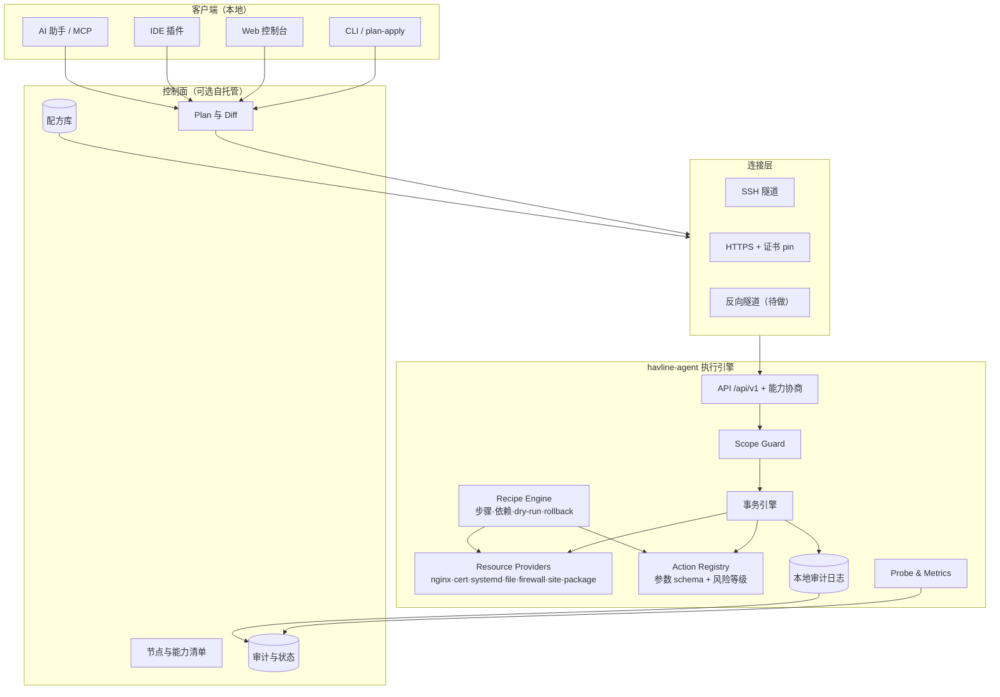

# havline-agent 场景化蓝图：从入口治理到服务器执行层

> 分析日期：2026-10-03
> 前置文档：`agent-standalone-project-analysis.md`（现状盘点与独立化方案）
> 本文主题：把 agent 的控制能力扩展到网站部署、软件安装、网络运维等更广场景时的产品定位、能力模型与落地路径
> 文档性质：方向讨论稿，不构成实施承诺

---

## 一、目标重述

要做的不是「再做一个服务器面板」，而是：

> **客户端（本地 CLI / Web / IDE 插件 / AI Agent）描述需求，服务器上的 agent 在受控边界内把它变成现实，并保证可校验、可回滚、可审计。**

三个关键词决定了这个方向能不能成立：

| 关键词 | 含义 | 为什么关键 |
| --- | --- | --- |
| **受控边界** | agent 只做被显式允许的事，其余一律拒绝 | 否则等价于开放远程 root shell，任何安全评审都过不了 |
| **可校验** | 变更前后都有事实依据（语法检查、健康探测、diff） | 决定用户敢不敢让它碰生产机器 |
| **可回滚** | 每次变更留下恢复点，失败能退回去 | 这是与 Ansible 式「一次性执行脚本」最本质的区别 |

现有 agent 已经在**入口配置**这一个领域做到了这三点（vhost 版本化回滚、`nginx -t` 校验、写前备份）。本文讨论的是把同一套方法推广到更多领域。

---

## 二、场景地图

按领域列出可覆盖的场景，并标注每个场景需要的「能力原语」、风险等级和现有 agent 的覆盖情况。

### 2.1 网站部署

| 场景 | 需要的原语 | 风险 | 可回滚 | 现状 |
| --- | --- | --- | --- | --- |
| 静态站 / SPA 部署 | 发布目录创建、文件同步、Nginx 站点 | 低 | 是（切目录） | 部分：有 Nginx vhost，无文件同步 |
| Node / PHP / Python 应用 | 运行时安装、进程托管、反代 | 中 | 部分（代码可回滚，运行时可多版本共存） | 无 |
| WordPress 等成品站 | 软件包、数据库、站点配置的组合配方 | 中 | 部分（数据库需单独备份） | 无 |
| Docker Compose 应用 | Compose 文件下发、镜像拉取、启停 | 中高 | 是（保留旧 compose + 镜像） | 无 |
| 多站点共存与端口/资源隔离 | 站点注册表、冲突检测 | 中 | 是 | 部分：单域名 vhost 已隔离 |

> 关键判断：**「网站部署」不应被实现为「执行一段部署脚本」**，而应实现为「站点资源 + 运行时资源 + 证书资源 + 反代资源」的声明式组合。这样每个部分都能单独 diff 和回滚。

### 2.2 环境初始化与软件安装

| 场景 | 需要的原语 | 风险 | 可回滚 | 现状 |
| --- | --- | --- | --- | --- |
| Web 服务器 | `package.install(nginx)` + 启动 | 中 | 可卸载，需谨慎 | 已具备（`POST /api/v1/nginx/install`） |
| 运行时（Node / Python / Go / Java） | 版本化安装、PATH 管理、多版本共存 | 中 | 是（多版本目录） | 无 |
| 数据库 / 缓存 | 安装、初始化、账号、基础加固 | 高 | 部分（数据不可回滚） | 无 |
| Docker / Compose | 安装、仓库配置、daemon 参数 | 高 | 部分 | 无 |
| 系统调优（文件数、内核参数、swap） | 配置文件资源 + 生效动作 | 中高 | 是（配置可回滚，重启才完全生效） | 无 |
| 时区 / 语言 / 主机名等基础设置 | 系统资源 | 低 | 是 | 无 |

> 关键判断：**「安装软件」是供应链动作，必须有来源白名单与校验**。现有 agent 对 frps 已做到（官方 checksum + 下载源白名单），这个模式应作为所有安装类动作的标准：**固定来源、固定校验、固定安装路径**，而不是「执行用户给的安装命令」。

### 2.3 反向代理与证书（现有强项）

| 场景 | 现状 |
| --- | --- |
| 域名 vhost 部署 / 删除 / 版本回滚 | 已具备 |
| 反代部署设置（白名单/黑名单、Basic Auth、限流、连接数、体积、超时、安全头、TLS1.3） | 已具备 |
| 证书推送与托管 | 已具备 |
| HTTPS 直连（证书 pin + 自检） | 已具备 |
| 中国 IP 段下发 | 已具备 |
| 证书到期巡检与自动续期编排 | 部分（仅回传 `not_after`，靠中央驱动） |
| 多 backend（Caddy / Traefik / HAProxy） | 无 |

### 2.4 网络与运维

| 场景 | 需要的原语 | 风险 | 现状 |
| --- | --- | --- | --- |
| 防火墙端口放行 | `firewall.allow(port)` | 中 | 已具备（仅 ufw / firewalld 自动，nftables/iptables 明确拒绝自动修改） |
| 端口占用与监听排查 | 只读探测 | 低 | 已具备（80/443/7000/8080） |
| DNS 解析诊断 | 只读查询 | 低 | 部分（frps 诊断里有 DNS 检查） |
| frps / frpc 编排 | 安装、配置、启停 | 中 | 已具备 |
| 内网互联 / VPN（WireGuard、Tailscale） | 配置资源 + 启停 | 中高 | 无 |
| 抓包 / 连通性诊断 | 只读命令 + 输出脱敏 | 低中 | 无 |
| 系统时间同步 / NTP | 配置资源 | 低 | 无 |

> 关键判断：**只读诊断能力应该优先做**——它风险最低、对运维的实际价值最高，而且能显著提升「敢把 agent 装到生产机」的意愿。

### 2.5 数据、备份与迁移

| 场景 | 需要的原语 | 风险 | 现状 |
| --- | --- | --- | --- |
| 站点目录 / 配置打包备份 | 打包动作 + 外送 | 低 | 无 |
| 数据库备份与校验 | 备份动作 + 完整性校验 | 中 | 无 |
| 定时备份策略 | 计划任务资源 | 中 | 无 |
| 跨机迁移（导出 → 导入） | 备份 + 恢复配方 | 高 | 无 |
| 配置快照与差异比对 | 已有的版本机制可复用 | 低 | 部分（Nginx / 证书） |

> 关键判断：**备份是「回滚」能力的前提**。对一个声称可回滚的产品，备份应该是最早补齐的能力之一，而且它本身风险低、收益高。

### 2.6 服务生命周期与观测

| 场景 | 需要的原语 | 风险 | 现状 |
| --- | --- | --- | --- |
| systemd 服务启停 / 状态（白名单 unit） | `service.action(unit)` | 中高 | 部分（仅 frps 硬编码） |
| 服务日志读取 | 只读日志 | 低 | 部分（Nginx、frps） |
| 主机指标 | 只读采集 | 低 | 已具备 |
| 结构化日志外送 / 事件流 | 推送 | 低中 | 无 |
| Prometheus `/metrics` | 只读 | 低 | 无 |
| 自定义健康探针（HTTP / TCP） | 只读探测 | 低 | 部分（vhost 回源自检） |

> 关键判断：**systemd unit 白名单是危险与价值的临界点**。开放任意 unit 启停 ≈ 半只脚踩进 root shell；只开放配置文件里声明的 unit 则可以接受。

### 2.7 安全加固

| 场景 | 需要的原语 | 风险 | 现状 |
| --- | --- | --- | --- |
| SSH 配置加固（禁密码、改端口、限用户） | 配置资源 + 校验 + 重载 | **高风险** | 无 |
| fail2ban / 登录防护 | 安装 + 配置资源 | 中 | 无 |
| 用户与密钥管理 | 用户资源、authorized_keys 资源 | 高 | 无 |
| 端口暴露面巡检 | 只读 | 低 | 部分 |
| 证书 / 密钥过期巡检 | 只读 | 低 | 部分 |

> 关键判断：**SSH 加固必须在协议层强制「先校验再生效 + 保底会话」**，因为配置写错会直接把运维人员锁在门外。这是典型的「可回滚但代价极高」操作，需要单独设计安全的执行窗口。

### 2.8 开发工作流

| 场景 | 需要的原语 | 风险 | 现状 |
| --- | --- | --- | --- |
| 拉取代码 / 构建 / 发布 | Git 动作、构建配方 | 中 | 无 |
| 环境变量与密钥注入 | 文件资源（0600） | 中高 | 无 |
| 发布与回滚（保留 N 个版本） | 发布资源 + 目录切换 | 中 | 无 |
| CI 触发（webhook 入站） | 入站端点 + 审批 | 中 | 无 |
| 运行日志聚合查看 | 只读 | 低 | 部分 |

---

## 三、核心设计：三层能力模型

这是整个方案里最重要的一节。要把「更多场景」做出来又不变成远程 shell，必须把能力分成三层，**层与层之间有明确的信任与校验规则**。

### 第一层：Resource（声明式资源）—— 主干，优先做

**特征**：描述「期望状态」，而不是「要执行的命令」。

```yaml
# 概念示例
kind: nginx.route
metadata: { domain: app.example.com }
spec:
  upstream: http://192.168.1.20:8080
  tls: { certificate: app.example.com, min_version: "1.2" }
  access: { allow_ips: ["1.2.3.0/24"], basic_auth: { user: ops } }
  limits: { rate: 20, burst: 40, max_body: 50m }
```

- 必须**幂等**：重复应用同一份声明不产生变化；
- 必须能 **plan**（输出将要发生的差异）；
- 必须能 **apply**（应用差异）与 **rollback**（退回上一个已知良好状态）；
- 实现上就是把现有 `putRoute` 的事务化逻辑（备份 → 写入 → 校验 → 回滚）抽象成通用流程。

**适用**：vhost、证书、站点、systemd unit 文件、防火墙规则、配置文件片段、用户、计划任务。

### 第二层：Action（受控动作）—— 补充，参数化白名单

**特征**：单一、明确、可审计的动词，参数有 schema 校验，不是自由命令。

```text
nginx.reload
nginx.install        { distro }
package.install      { name, version? }   # name 必须来自允许清单
service.restart      { unit }             # unit 必须来自声明清单
backup.run           { paths, dest }
cert.renew           { domain }
firewall.allow       { port, protocol }
```

- 参数必须是**结构化字段**，不能是命令字符串；
- 每个动作声明：风险等级、是否可回滚、是否需要审批、需要的 capability；
- 现有 agent 的动作（`nginx/install`、`frps/install`、`frps/action`、`firewall/allow`、`nginx/reload`）就是这个层级的雏形，只需补上 registry 与 schema。

### 第三层：Recipe（配方）—— 覆盖泛化需求的关键

**特征**：由 Resource 与 Action 组成的步骤化编排，声明式 YAML，可参数化、可 dry-run、可审批。

```yaml
# 概念示例：部署一个 Node 应用
name: deploy-node-app
params:
  domain:        { type: string, required: true }
  git_repo:      { type: string, required: true }
  node_version:  { type: string, default: "20" }
steps:
  - resource: runtime.node      { version: "{{ node_version }}" }
  - resource: site.release      { name: app, source: git, repo: "{{ git_repo }}" , keep: 3 }
  - action:   service.restart   { unit: app.service }
  - resource: nginx.route       { domain: "{{ domain }}", upstream: http://127.0.0.1:3000 }
  - resource: certificate       { domain: "{{ domain }}" }
verify:
  - probe: http.get { url: "https://{{ domain }}/healthz", expect: 200 }
rollback:
  - resource: site.release { name: app, action: previous }
  - resource: nginx.route  { domain: "{{ domain }}", action: previous }
```

为什么这一层是关键：

- **它把「任意需求」收敛成「可枚举的配方」**。用户要的是「部署网站」「装软件」，不是「执行我的脚本」；
- 配方可被**审核、签名、版本化、分享**，形成可积累的资产（配方库 / 市场），这正是 Ansible role、Terraform module 的价值所在；
- 每个步骤落到前两层，因此安全边界、幂等、回滚能力天然继承。

**明确不做**：不提供「自定义 shell 步骤」入口，或只提供需要独立开关 + 高危审批 + 明确标注「不可回滚」的受限通道。

### 三层的信任规则

| 层 | 是否需要审批 | 可回滚性 | 需要的 capability |
| --- | --- | --- | --- |
| Resource | 默认不需要（幂等、可回滚） | 高 | `resource:<type>:write` |
| Action | 中高风险动作需要 | 视动作 | `action:<name>:execute`；高危单独授予 |
| Recipe | 首次运行需要（可记住授权） | 取决于步骤 | `recipe:<name>:run` + 各步骤能力 |

---

## 四、配套机制（决定这个产品能否被信任）

### 4.1 Scope Guard（作用域闸门）

在 agent 侧硬性限制可触及的范围，配置化、默认最小：

| 维度 | 限制方式 |
| --- | --- |
| 文件系统 | 只允许声明目录（`/etc/nginx/...`、`/var/www/...`），路径规范化后校验前缀，拒绝 `..` 与符号链接逃逸 |
| systemd | 只允许声明 unit 列表（而不是任意 unit） |
| 软件包 | 只允许声明包名清单 + 固定来源仓库 |
| 端口 | 只允许放行声明端口，且拒绝危险端口范围（如 22 变更需显式开关） |
| 执行 | 只允许 registry 中的动作；无 shell 透传 |
| 网络出站 | 只允许白名单目标（软件源、Git 主机、ACME） |

### 4.2 能力分级 Token

把当前的单一全权 Bearer Token 拆成能力集：

```text
route:read   route:write
cert:read    cert:write
service:read service:write
package:install
firewall:write
host:read            # metrics / logs
recipe:run
```

- 一个客户端只拿到它需要的能力；
- 高危能力（`package:install`、`ssh:write`）单独签发并支持撤销；
- 能力清单在 `GET /api/v1/capabilities` 中暴露，控制面据此决定 UI 显示什么。

### 4.3 变更事务

把现有 vhost 的逻辑抽象成通用事务：

```text
Plan    → 计算差异（不落盘）
Snapshot→ 备份受影响文件与状态，记录回滚点
Validate→ 语法/语义校验（配置文件可 `-t`，其他类型需各自校验器）
Apply   → 原子写入 + 重载/生效
Verify  → 健康探测（HTTP / 端口 / 进程）
Commit  → 记录审计事件
         ↓ 任一步失败
Rollback→ 恢复回滚点并重新校验
```

**关键**：每一步都要显式声明「是否可回滚」。不可回滚的步骤（安装软件包、数据库迁移、DNS 变更、SSH 配置）必须在 plan 阶段就向用户明确标注。

### 4.4 审计与事件流

每次变更产生结构化事件：操作者标识、能力、配方/资源、参数摘要（脱敏）、前后 diff、结果、回滚点、耗时。

- 本地保留最近 N 条，支持导出；
- 可推送 webhook / syslog / 对象存储；
- 这是企业交付的硬前提，也是「AI 运维」场景里唯一的责任追溯手段。

### 4.5 审批闸门

| 场景 | 闸门 |
| --- | --- |
| 高危动作（SSH 加固、用户变更、包卸载） | 需要一次性确认令牌（由客户端生成、用户输入） |
| 首次运行配方 | 需要显示完整 plan 并确认 |
| AI 发起的变更 | 协议层强制「提议 → 人确认 → 执行」，不允许 AI 直接持有高危能力 |
| 批量节点 | 需要分批 + 健康门槛 + 自动暂停 |

---

## 五、架构蓝图



设计要点：

1. **控制面可选**：agent 必须能在「只有一个 CLI，没有中央服务」的情况下被完整驱动。这样既降低了部署门槛，也让 agent 本身可被第三方集成。
2. **执行引擎在 agent 侧**：控制面只负责描述与编排，不直接触碰服务器。这是与「面板和服务器同机」的传统方案（宝塔、1Panel）最本质的结构差异——面板被攻破不直接等于服务器被攻破。
3. **Provider 可扩展**：新增领域（比如 Caddy、Docker、PostgreSQL）应该是新增 Provider，而不是改核心。

---

## 六、对标与差异化

| 项目 | 模型 | 与本方向的差异 |
| --- | --- | --- |
| Ansible | 无 agent，SSH 推 YAML playbook | 我们不要求目标机有 Python、不依赖 SSH 免密；提供**常驻 agent + 能力分级 + 事务回滚 + 状态查询**。Ansible 是「批量自动化」，我们更偏「交互式、少量节点、高风险操作的精确控制」 |
| SaltStack / Puppet / Chef | agent + 状态收敛 | 我们更轻（单二进制、无运行时依赖），且把「回滚点」作为一等公民，而不是只做收敛 |
| Terraform | 声明式 + plan/apply | 我们不做云资源，但**术语与体验可以对齐**（plan 先看差异），这对开发者是熟悉的肌肉记忆 |
| 宝塔 / 1Panel | 面板与服务器同机，全权 | 我们是**分离式**：本地客户端 + 服务器只装 agent；面板暴露面不落在生产机上；不绑定容器 |
| Coolify / Dokploy / Komodo | 中央 + 节点，聚焦应用部署 | 我们覆盖更宽（网络运维、系统配置、安全加固），且不要求 Docker |
| Portainer | 容器管理 | 不重叠，可并存 |
| frp-panel | 多节点 frp 控制台 | 我们在 frp 之上还有系统层与站点层 |
| Rundeck / AWX / Semaphore | 作业编排、审批、RBAC | 它们解决「编排与审批」，需要一个执行端；**agent 正好可以作为它们的执行端**（互补而非竞争） |
| Tailscale / Cloudflare Tunnel | 连接层 | 解决「怎么到达」，我们解决「到达之后做什么」；可作为连接层被复用 |
| MCP / AI Agent 生态 | AI 调用工具 | 我们提供带审批与回滚的执行端，正好补上 AI 运维最缺的那一环 |

**一句话差异化**：

> 别人给你「批量执行」或「全权面板」；我们给你**「在受控边界内、可先看计划、可回滚、可审计地改变服务器状态」**。

---

## 七、MVP 建议

如果只挑一条最短路径来验证这个方向，我建议这样切：

**验证目标**：证明「用配方描述一次网站部署，比写脚本更安全、更可回滚」，且用户愿意用。

**MVP 范围（建议 6–10 周）**

1. **协议层**：`/api/v1/capabilities`、能力分级 Token、审计事件、`plan/apply/rollback` 三段式；
2. **Resource Providers（3 个）**：`nginx.route`（已有，抽象化）、`certificate`（已有，抽象化）、`site.release`（新增：发布目录 + 保留 N 版 + 切换）；
3. **Action Registry（4 个）**：`nginx.reload`、`nginx.install`、`service.restart`（白名单 unit）、`package.install`（白名单包名）；
4. **Recipe Engine**：YAML 步骤、参数校验、dry-run、逐步骤回滚；
5. **内置配方（3 个）**：
   - `deploy-static-site`：目录发布 + 证书 + 反代；
   - `deploy-node-app`：运行时安装 + 发布 + systemd unit + 反代 + 证书；
   - `harden-nginx`：安全头 + 限流 + 日志轮转；
6. **Scope Guard**：文件前缀、unit 白名单、包名白名单；
7. **客户端**：CLI（`plan` / `apply` / `rollback` / `audit`），Web 后续再接。

**不放进 MVP**：SSH 加固、用户管理、数据库、Docker 编排、多节点批量、SaaS 控制面。这些等 MVP 验证后被真实需求拉出来再做。

---

## 八、风险与反面意见

必须写在前面，避免自我说服：

1. **赛道重叠最严重**：Ansible 生态已经极其成熟，1Panel / 宝塔占据中文服务器的存量用户。如果不能清晰回答「为什么不用 Ansible」，这个方向会变成自娱自乐。我认为唯一站得住的答案是**「事务化 + 能力分级 + 交互式精确控制」**，而不是「更全的功能」。
2. **「更多场景」等于「更大攻击面」**：每加一个 Provider / Action，就多一处可能被滥用或被注入的表面。必须坚持「Scope Guard 先于 Provider」的开发顺序。
3. **回滚不是万能的**：装包、数据库、DNS、SSH 配置都可能不可逆。产品必须在 UI 和协议上都诚实地标注，否则一次失败就会失去用户信任。
4. **跨发行版适配成本被低估**：apt / dnf / yum / apk、systemd / openrc、不同 Nginx 布局（`sites-enabled` vs `conf.d`，宝塔 / 1Panel 自带 Nginx）——现有 `detectNginxConfDir` 已经踩过一轮坑，推广到更多软件时这个成本会成倍上升。
5. **长任务与交互**：编译、下载、数据库迁移都是分钟级甚至更久，需要任务队列、日志流、断线重连与幂等重入。现有 API 是同步的，这是必须解决的架构问题。
6. **版本矩阵**：agent 独立发版后，能力 × 发行版 × 后端软件的组合会迅速膨胀，必须靠 capability 协商而不是版本号判断。

---

## 九、落地路线

| 阶段 | 目标 | 关键产出 | 判断继续的条件 |
| --- | --- | --- | --- |
| S0 基础 | 把现有能力事务化、抽象化 | 三层模型落地、能力 Token、审计、plan/apply | 现有 Havline 场景不回归 |
| S1 单机 MVP | 证明配方比脚本好 | 3 Provider + 4 Action + Recipe Engine + 3 内置配方 + CLI | 真实用户用它部署过至少一个站点 |
| S2 扩展 | 覆盖更多开发者需求 | site.release 增强、运行时安装、环境变量注入、发布回滚、`/metrics` | 出现重复使用的配方（不是一次性尝鲜） |
| S3 运维面 | 吸引网络运维用户 | 只读诊断集、防火墙与端口、备份与恢复、systemd 白名单 | 有用户把它装在非 Havline 的机器上 |
| S4 编排 | 多节点与协作 | 配方库、审批流、批量与灰度、Web 控制台 | 出现真实多节点诉求 |
| S5 生态 | 被集成 | Terraform provider、MCP server、CI webhook | 外部调用方出现 |

**贯穿始终的一条纪律**：每个新能力都必须先回答三个问题——**Scope 是什么、能不能回滚、需要什么能力位**。答不上来就不做。

---

## 十、结论

- 这个方向的**技术可行性已经由现有 agent 证明**：vhost 已实现「备份 → 校验 → 应用 → 失败回滚 → 版本回滚」，把它抽象成通用事务，就能覆盖更多领域。
- 覆盖「网站部署、软件安装」的正确姿势不是**开放命令执行**，而是**Resource + Action + Recipe 三层模型**：声明式资源保证幂等与回滚，受控动作保证可审计，配方把泛化需求收敛成可审核、可复用的资产。
- 与 Ansible、1Panel、宝塔的差异化必须建立在**「事务化 + 能力分级 + 交互式精确控制」**上，而不是功能数量。如果只能说出一句卖点，应该是：**「先看计划，再改服务器，出错能退回去」**。
- 最短验证路径是 **S1 单机 MVP**：3 个 Provider、4 个 Action、1 个 Recipe Engine、3 个内置配方、1 个 CLI。跑通后再谈多节点与生态。
- 最大的长期风险不是技术，而是**信任**：一个能改服务器状态的工具，只要有一次「说能回滚结果没退回去」，就很难再被装到生产机上。回滚能力必须比新功能优先级更高。
