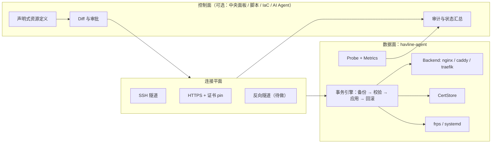

# havline-agent 独立项目化分析

> 分析日期：2026-10-03
> 分析对象：`internal/agent`（`havline-agent`，AgentVersion `0.15.0`）
> 分析方式：源码通读（25 条 API 路由、安全模型、依赖关系）、安装脚本核对、同类开源项目调研
> 文档性质：产品与技术方向讨论稿，不构成实施承诺
>
> 延伸阅读：如果把 agent 的控制能力扩展到网站部署、软件安装等更广场景，见 `agent-server-automation-vision.md`（场景地图与 Resource/Action/Recipe 三层能力模型）。

---

## 一、结论摘要

`havline-agent` 不是一个「监控探针」，而是一个**运行在公网服务器上、以 root 身份代中央面板执行受控变更的节点执行器**。它当前的价值集中在四件事上：

1. **Nginx 站点托管**：写入 vhost、`nginx -t` 校验、重载，失败自动回滚，并保留最多 10 个历史版本；
2. **frps 生命周期**：从 GitHub Release 下载安装包（SHA-256 校验 + 加速代理白名单）、写配置、启停、读回配置与日志；
3. **证书与传输**：接收证书推送、可自行配置 HTTPS 直连并做自检；
4. **节点事实采集**：主机指标、Nginx 日志尾部、端口占用、防火墙状态、路由漂移所需的存在性/加载状态。

它已经具备独立产品的**技术骨架**，但**产品定义、协议演进和安全模型**都还绑定在 Havline 的具体用法上。如果要做独立项目，我的判断是：

- **值得做**，但价值不在「再写一个 frp 面板」，而在于「**把服务器变更做成可校验、可回滚、可审计的事务**」这一层抽象；
- **第一步应该是「解耦发行」，不是「另起产品」**：先把 agent 拆成可独立版本、独立升级、协议向后兼容的组件（方案 A）；
- **第二步是「通用节点执行器」**：抽象出 Nginx / Caddy / frps / systemd 等 backend，让其他面板或自建平台也能接入（方案 B）；
- **第三步才是「多节点编排平台」**：声明式配置、节点组、灰度与漂移治理（方案 C），这一步的竞争对手是 Coolify / Dokploy / Portainer 这类成型项目，需要明确差异化才值得投入。

最大的**未解风险**是权限模型：agent 以 `User=root` 运行，等价于把宿主机高权限暴露给一个 HTTP 接口。当前靠「回环监听 + Bearer Token + SSH 隧道 + 证书 pin」把攻击面收窄，这在「面板自己调用」的模型下是合理的，但**在独立产品、多租户、或接入第三方调用方时不够**。

---

## 二、现状盘点

### 2.1 定位与部署形态

| 项 | 现状 |
| --- | --- |
| 交付物 | 单个 Linux 二进制 `havline-agent`（amd64 / arm64），无 CGO |
| 安装方式 | `scripts/agent-install.sh`：安装到 `/usr/local/bin`，写 `/etc/havline-agent/agent.env`，注册 systemd |
| 运行身份 | systemd `User=root`、`Restart=on-failure`，`After=network-online.target nginx.service` |
| 默认监听 | `127.0.0.1:7700`，非回环监听必须显式 `HAVLINE_AGENT_ALLOW_REMOTE=1` |
| 鉴权 | `Authorization: Bearer <token>`，常量时间比较；Token 由安装脚本用 `/dev/urandom` 生成（32 字节 hex） |
| 调用方式 | 中央 Havline 经 SSH 隧道访问回环端口；或配置 HTTPS 直连 + 证书 pin |
| 数据目录 | `/var/lib/havline-agent`（探测缓存、限流状态、HTTPS 代理状态） |
| 证书目录 | `/var/lib/havline-agent/certs/<domain>/`（`fullchain.pem` / `privkey.pem`，权限 0600） |

### 2.2 API 表面（25 条路由）

| 分组 | 端点 | 说明 |
| --- | --- | --- |
| 探活 | `GET /api/v1/ping`、`GET /api/v1/status` | 服务标识、监听范围、传输安全、Nginx 探测、frps 状态、端口占用、路由清单 |
| 路由 | `GET/PUT /api/v1/routes`、`GET /api/v1/routes/{domain}/conf`、`DELETE /api/v1/routes/{domain}` | vhost 部署、读取、删除；写入时做 Nginx 预检与回源自检 |
| 版本 | `GET /api/v1/routes/{domain}/versions`、`.../versions/{name}`、`POST .../versions/{name}/rollback` | 每个域名最多 10 个历史版本，支持查看与回滚 |
| Nginx | `POST /api/v1/nginx/install`、`POST /api/v1/nginx/reload` | 一键安装（apt/dnf/yum/apk）、显式重载 |
| 传输 | `PUT/GET/DELETE /api/v1/transport/https` | 配置 HTTPS 直连（候选端口自动选择）、查询证书到期时间、移除 |
| 防火墙 | `GET /api/v1/firewall`、`POST /api/v1/firewall/allow` | 只读探测 ufw/firewalld/nftables/iptables；仅 ufw/firewalld 可自动放行 |
| frps | `POST /api/v1/frps/install`、`POST /api/v1/frps/action`、`PUT/GET /api/v1/frps/config` | 下载校验安装、启停、配置写入与回读 |
| 证书 | `POST /api/v1/certs`、`GET /api/v1/certs` | 接收证书推送、列出已托管证书 |
| 观测 | `GET /api/v1/metrics`、`GET /api/v1/logs/nginx` | 主机 CPU/内存/磁盘/负载/运行时长；Nginx access / error 日志尾部 |
| 其他 | `PUT /api/v1/china-cidr` | 下发中国 IP 段用于 geo 规则 |

### 2.3 已经做对的工程决策

这些是独立化时可以**直接继承**的资产：

- **写前备份、校验失败回滚**：`applyRouteContent` 先落版本、再写入、`nginx -t` 失败则恢复上一版；HTTPS 配置同样处理。避免了「校验失败就把在跑的站点从磁盘抹掉」这类事故。
- **幂等安装**：`POST /api/v1/frps/install` 重复调用等价于升级；Nginx 安装先探测再跳过。
- **供应链校验**：frps 安装包先取官方 checksum 再下载，做 SHA-256 比对；下载源限定官方与白名单加速前缀。
- **输入面收敛**：域名正则校验、请求体上限（4KB–16MB 分级）、日志路径**不接受请求参数**（从 `nginx -T` 实际生效配置推导），避免变成任意文件读取。
- **探测缓存与节流**：Nginx 探测、CPU 采样（1 秒窗口）都有缓存，避免状态轮询把 `nginx -t` 变成 DoS。
- **敏感值不落配置**：Basic Auth 自动生成的密码只在响应里回一次，不写入配置注释（避免「查看配置」永久泄露）。
- **纯 Go apr1**：不依赖系统 `openssl`，跨发行版稳定。

### 2.4 与主项目的耦合面

| 耦合点 | 内容 | 拆分影响 |
| --- | --- | --- |
| 内部包依赖 | `internal/fsutil`（版本目录、原子写）、`internal/nginxtmpl`（模板）、`internal/sysinfo`（指标） | 需要把这些抽成独立模块或复制为 vendor 子包 |
| 调用方 | `internal/frp/agent_client.go`（429 行）：Bearer + 证书 pin + 超时策略 | 需定义公开协议契约，而非 Go 客户端内部约定 |
| 安装链路 | `internal/frp/ssh_installer.go`、`scripts/agent-install.sh`、内嵌二进制 `internal/frp/agentbin` | 独立项目需要自己的发行与升级通道 |
| 版本矩阵 | `AgentVersion` 与主程序能力探测（`wrapEndpointMissing`、兼容性测试） | 独立发版会放大版本兼容成本 |
| 命名与标识 | 服务名 `havline-agent`、路径 `/etc/havline-agent`、`/var/lib/havline-agent` | 改名涉及迁移脚本 |

**量级评估**：`internal/agent` 非测试实现约 2.8k 行（`server.go` 单文件 1766 行），另有 9 个测试文件。拆分本身工作量不大，真正的成本在**协议设计、版本兼容和多调用方支持**。

---

## 三、同类项目对标

| 项目 | 类型 | 与 havline-agent 的关系 | 可借鉴点 |
| --- | --- | --- | --- |
| [frp-panel](https://github.com/VaalaCat/frp-panel)（VaalaCat） | 多节点 frp Web 控制台（Master + Worker） | 功能重叠最多的项目：同样管 frps/frpc、多节点、实时日志 | Master/Worker 分离、统一凭据分发、Worker 边缘化 |
| [Nginx Proxy Manager](https://github.com/NginxProxyManager/nginx-proxy-manager) | 反代 GUI（单体，含 Nginx） | 用户群重叠；它把 Nginx 和 UI 放一起 | 多用户角色、审计日志、上手体验 |
| [Traefik](https://github.com/traefik/traefik) / [Caddy](https://github.com/caddyserver/caddy) | 现代反向代理 | 是「agent 要驱动的 backend」的替代实现 | 声明式配置、自动 HTTPS、动态 provider 抽象 |
| [Coolify](https://github.com/coollabsio/coolify) / [Dokploy](https://github.com/Dokploy/dokploy) | 自托管 PaaS | 同属「中央面板 + 节点执行」范式，但面向应用部署而非入口治理 | 节点注册流程、资源占用控制（Dokploy 闲置约 350MB / 1% CPU） |
| [Portainer](https://docs.portainer.io/start/architecture)（Server + Agent） | 容器管理 | Agent 架构最成熟的参考：**Agent 无状态、数据回传 Server**、一个 Server 接多个 Agent | 无状态化、故障域隔离、air-gap 支持 |
| [Beszel](https://github.com/henrygd/beszel) | 轻量监控（Hub + Agent） | 证明「Go 单二进制 + 一键脚本 + 低占用」的 agent 分发模型可行 | 安装体验（一条命令）、空闲 10–15MB 内存 |
| node_exporter / Netdata | 指标采集 | 只做观测，不做变更 | `/metrics` 暴露、采集与动作分离 |
| [Cockpit](https://cockpit-project.org/) / Webmin | 服务器管理面板 | 直接对标「agent 的权限边界」争论：Cockpit 限定服务管理，Webmin 全 root | 能力分级、限定作用域 |
| Tailscale / Cloudflare Tunnel | 连接层 | 与 agent 竞争「如何安全到达内网」 | 出站连接优先、无需开放入站端口 |

### 3.1 差异定位

把上表压缩成一句话，havline-agent 的差异点是：

> 别人管**容器**（Portainer/Coolify/Dokploy）、管**指标**（Beszel/netdata）、管**连接**（Tailscale/Cloudflare），或管 **frp 控制台**（frp-panel）；
> havline-agent 管的是**「服务器上的入口配置」这件事本身**——vhost、证书、vhost 与 frps 的协同，并且**把每次变更做成带回滚的事务**。

这个差异点是真的，但目前**没有被产品化表达**：没有独立的配置模型、没有 audit 语义、没有 backend 抽象，所以外部看不到「事务」这个卖点。

---

## 四、独立化的三种定位方案

### 方案 A：Havline Node —— 作为主项目的独立发行组件

**定位**：仍是 Havline 的一部分，但独立版本、独立升级、独立仓库或独立目录。

- 收益：版本矩阵可控、agent 可独立热修（不必发主程序）、第三方可只部署 agent。
- 代价：最小，主要是协议冻结与迁移脚本。
- 适用：当前阶段最务实的一步。

**关键动作**：抽出 `agent` 模块依赖 → 定义 `agent-protocol.md`（v1 契约）→ agent 自带 `-version` 与升级端点 → 主程序做能力协商（不靠版本号硬判）。

### 方案 B：通用节点执行器（Node Actuator）

**定位**：一个面向「任何控制面」的节点变更 API。控制面可以是 Havline，也可以是脚本、Ansible、Terraform provider、甚至 AI Agent。

- 核心抽象：`backend` 接口（nginx / caddy / traefik / haproxy / frps / systemd）+ `changeset`（事务）+ `capabilities`（能力协商）。
- 收益：从「Havline 的内部件」变成「可被集成的组件」，获得外部使用者的可能性。
- 代价：中。需要 backend 抽象、配置模型、稳定协议、审计与权限分级。
- 关键风险：如果做成「能执行任意命令的远程 root API」，会被安全社区直接劝退；**必须限定在声明式、可校验、可回滚的资源操作**上。

### 方案 C：多节点编排平台（Fleet）

**定位**：中央控制面 + 多节点，做声明式入口治理：节点组、漂移报告、灰度下发、证书编排、批量滚动。

- 收益：产品上限最高，可做 SaaS 或企业版（审计、SSO、RBAC）。
- 代价：高。直接进入 Coolify / Dokploy / frp-panel / Portainer 的竞争区间，且需要长期维护。
- 前提：方案 A/B 已经在真实环境里跑稳，并积累到「多节点」的真实需求（不是想象的需求）。

**推荐路径**：A（1–2 周）→ B（1–2 个月，看是否真有外部调用方）→ C（只有出现明确的多节点用户诉求才启动）。

---

## 五、能力扩展联想

以下按主题列「可以做」的方向，标注价值与代价，供筛选。

### 5.1 连接与传输

| 想法 | 价值 | 代价 |
| --- | --- | --- |
| **反向隧道（agent 出站连中央）** | 高。彻底去掉「中央要能 SSH 到节点」和「开放入站端口」两个前提，才是 Tailscale 级别的体验 | 中高：长连接、重连、多路复用、NAT 穿透 |
| mTLS 双向认证替代裸 Bearer | 高。把「共享密钥」升级为「节点身份」 | 低中：证书签发与轮换 |
| 节点注册令牌（一次性） | 中。安装即注册，省去手工复制 Token | 低 |
| WireGuard / Tailscale 适配器 | 中。复用成熟连接层而不是自研 | 中 |
| 多路径回退（SSH → HTTPS pin → 隧道） | 中。已有部分实现，可显式化策略 | 低 |

### 5.2 配置模型与 GitOps

| 想法 | 价值 | 代价 |
| --- | --- | --- |
| **声明式资源模型**（`Route` / `Certificate` / `FrpsServer`） | 高。当前 API 是「动作导向」，声明式才能做 diff、dry-run、幂等 | 中 |
| dry-run / plan 输出 | 高。与「事务」卖点天然契合：先给 diff 再执行 | 低（已有校验能力） |
| 从 Git 拉取期望状态 | 中高。agent 主动拉，控制面只存声明 | 中 |
| Caddy / Traefik backend 适配器 | 中高。Nginx 之外的用户群很可观 | 中高（模板语义差异大） |
| 配置规范化与冲突检测（跨域名/端口） | 中。目前端口冲突主要靠上层判断 | 中 |

### 5.3 证书与密钥

| 想法 | 价值 | 代价 |
| --- | --- | --- |
| 边缘 ACME（agent 自己申请，中央只下发 DNS 凭据策略） | 中高。减少私钥长途传输 | 中高 |
| 证书轮换编排 + 到期预警 + 提前换发 | 高。当前只有 `not_after` 只读，靠中央驱动 | 低中 |
| 私钥不出节点（只回传指纹与到期） | 高。安全叙事更硬 | 中 |
| 证书与 vhost 的一致性巡检 | 中。已具备部分素材（certs 列表 + route conf） | 低 |

### 5.4 可观测性

| 想法 | 价值 | 代价 |
| --- | --- | --- |
| `GET /metrics`（Prometheus 文本格式） | 高。把 agent 接入现成监控栈，成本极低 | 低 |
| 结构化日志推送（而非拉取尾部） | 中高。现在只能中央轮询 tail | 中 |
| 多视角探测（从节点测中央、测外部端点） | 中。健康判定更可信 | 低中 |
| 变更事件流（webhook / SSE） | 中高。为审计与自动化提供基础 | 中 |

### 5.5 运维动作（需谨慎扩权）

| 想法 | 价值 | 代价 / 风险 |
| --- | --- | --- |
| systemd 服务托管（启停/状态，白名单 unit） | 中高 | 中。必须白名单，否则等于远程 root shell |
| 软件包安装（Nginx/frps 之外的组件） | 中 | 高。供应链与破坏性风险 |
| 备份执行（配置与证书打包外送） | 中 | 低中 |
| 只读免鉴权的 `/healthz` | 低 | 低（注意别泄露版本细节） |
| Docker 精简支持（容器重建） | 中 | 高。与 Portainer 正面竞争，不建议早期做 |

### 5.6 安全与治理

| 想法 | 价值 | 代价 |
| --- | --- | --- |
| **能力分级**（`route:write`、`cert:write`、`frps:admin`、`metrics:read`） | 高。Token 可只授予一类能力 | 中 |
| **非 root 模式**（sudoers 白名单 + 文件属主约束） | 高。回答「为什么要 root」这个必然被问的问题 | 中高 |
| 审计日志（谁、何时、改了什么、结果、回滚点） | 高。企业交付的硬需求 | 中 |
| 变更审批门槛（危险操作需二次确认令牌） | 中 | 低 |
| 配置模板注入面清理（IP 列表、体积、超时的结构化校验） | 高。当前用户可控字段拼进 Nginx 配置，是长期风险 | 中 |

### 5.7 节点群与编排

| 想法 | 价值 | 代价 |
| --- | --- | --- |
| 节点组 + 批量下发（滚动/灰度） | 高（方案 C 核心） | 高 |
| 漂移报告（期望 vs 实际） | 高。已具备单节点素材 | 中 |
| 一键批量升级节点（带健康检查与回滚） | 高 | 中高（节点失联会很难收场） |
| 节点标签与调度（按区域/机房分配入口） | 中 | 中 |

### 5.8 生态集成

| 想法 | 价值 | 代价 |
| --- | --- | --- |
| Terraform provider / Ansible collection | 中高。进入基础设施即代码工作流 | 中 |
| **MCP server**（把节点能力暴露为工具，供 AI 运维调用） | 中高且时机好；必须带「危险操作需人工确认」闸门 | 低中 |
| Webhook / 事件总线（变更、证书到期、节点离线） | 中高 | 低 |
| 官方 Helm / Compose 一键部署 | 中 | 低 |

---

## 六、架构建议

### 6.1 三个平面



要点：**控制面可替换**。把 agent 做成「无控制面也能被驱动」的组件，才谈得上独立项目。

### 6.2 协议

- 保持 JSON over HTTP、`/api/v1` 前缀，新增 `GET /api/v1/capabilities` 声明支持的能力与 backend，替代按版本号猜能力。
- 变更接口引入声明式语义：`PUT /api/v1/routes/{domain}` 保持现状（幂等），新增 `POST /api/v1/changesets`（多资源事务 + plan/apply 两段式）。
- 错误响应统一结构化（`code` / `message` / `details` / `rollback`），便于控制面做重试与提示。

### 6.3 状态与幂等

- 明确区分**缓存**（`nginx_conf_dir`、探测结果、metrics）与**状态**（限流状态、HTTPS 代理状态、证书目录），独立项目里应把缓存设计为可丢弃。
- 现在「删除路由会连同版本历史一起删」是合理的产品决策，但应在协议层显式表达（例如 `?keep_versions=true`）。

### 6.4 Backend 抽象（方案 B 的核心）

建议抽取的最小接口：

```text
Backend interface {
    Name() string
    Capabilities() []string
    Validate(desired) error
    Plan(current, desired) (Diff, error)
    Apply(diff) (rollbackToken, error)
    Rollback(rollbackToken) error
    Probe() (Health, error)
}
```

Nginx 已有实现可直接包装。**不建议**一开始就同时支持多 backend：先把 Nginx 事务化打磨好，再以「社区插件」形式引入 Caddy。

---

## 七、安全模型（最重要的待办）

### 7.1 现状的风险点

| 风险 | 现状 | 建议 |
| --- | --- | --- |
| 进程权限 | systemd `User=root`，因为要写 Nginx 配置、装包、操作 systemd | 提供非 root 模式：文件属主 + sudoers 白名单（`nginx -t`、`systemctl reload nginx`、指定 install 脚本） |
| 令牌 | 单一 Bearer Token，全能力 | 能力分级 Token + 轮换 + 撤销 |
| 控制面身份 | 证书 pin（客户端侧校验服务端），服务端不校验客户端证书 | mTLS 或节点身份证书 |
| 用户可控字段 | 域名/上游/IP 列表/体积/超时进入 Nginx 配置模板 | 结构化校验 + 模板白名单 + 生成后 `nginx -t`（已有最后一道） |
| 审计 | 有操作结果，无独立审计流 | 变更审计事件（含回滚点、发起方标识） |
| 供应链 | frps 已做 SHA-256 + 源白名单 | 扩展到 cloudflared、自升级、脚本下载 |
| 暴露面 | 回环 + SSH 隧道（默认安全） | 保留默认；直连模式强制 HTTPS + pin |

### 7.2 一句话原则

> agent 的能力边界应该由**「可声明、可校验、可回滚的资源操作」**定义，而不是由「能执行哪些命令」定义。任何越界的操作（任意命令、任意文件路径、任意 unit）都应该是显式配置项 + 默认关闭。

---

## 八、风险与「不做」清单

**主要风险**

1. **定位漂移**：做成「小号 Portainer/Coolify」会失去差异点，且竞争不过成熟项目。
2. **权限叙事过不去**：root + HTTP 接口的组合，在任何安全评审里都会被质疑；没有能力分级与非 root 模式，企业场景基本无解。
3. **版本兼容爆炸**：独立发版后，agent 版本 × 主程序版本 × backend 组合会迅速增加；必须靠能力协商缓解。
4. **多节点运维复杂度**：节点失联、部分成功、状态收敛，是方案 C 最难的部分，容易低估。
5. **上游变化**：frp 的校验文件名、下载结构、配置格式都变过（代码里已有 `fetchChecksumForCandidates` 兜底），依赖上游的模块需要持续跟进。

**建议不做（至少早期不做）**

- 不做任意命令执行 / Shell 透传；
- 不做容器编排（Portainer/Coolify 的地盘）；
- 不做通用指标时序库（Beszel/Netdata 的地盘）；
- 不做多租户 SaaS 控制面（在 A/B 验证前）；
- 不做 Windows 支持（当前实现强依赖 Linux 语义：`nginx -T`、systemd、ufw/firewalld）。

---

## 九、落地路线建议

| 里程碑 | 目标 | 产出 | 预估 |
| --- | --- | --- | --- |
| M0 解耦 | agent 可独立版本、独立升级；依赖自洽 | 独立目录/仓库、`agent-protocol.md` v1、`/api/v1/capabilities`、能力探测替代版本判断 | 1–2 周 |
| M1 安全 | 回答「为什么 root」 | 能力分级 Token、非 root 模式（sudoers 白名单）、审计事件、`/metrics` | 3–5 周 |
| M2 协议 | 从动作导向到声明式 | `changesets`（plan/apply/rollback）、结构化错误、dry-run | 4–6 周 |
| M3 开放 | 让外部能接入 | backend 抽象（Nginx 先行）、文档 + SDK（Go/HTTP）、Terraform provider 试用 | 2–3 个月 |
| M4 编排 | 多节点（视需求） | 节点组、漂移报告、批量滚动与回滚 | 视反馈 |

**判断是否进入 M3/M4 的信号**：是否出现**非 Havline 的调用方**（外部面板、IaC、脚本）；是否出现**真实的 3 个以上节点**的管理诉求。没有这两个信号，做 M0/M1 的收益（可维护性、安全性）就足够了。

---

## 十、需要注意的一个现成机会

当前 agent 的能力组合（受控变更 + 校验回滚 + 事实采集）**天然适合作为 AI 运维的执行端**：把 API 暴露为 MCP 工具，让 AI 提出变更、由 agent 校验并执行、失败回滚，人工只做审批。这条路径的门槛不在技术，而在**危险操作的确认闸门**——必须把「AI 提议 → 人确认 → agent 执行」做成协议级约束，否则会变成「给 AI 一把 root 钥匙」。

---

## 十一、最终判断

- 独立化**技术上可行**，`internal/agent` 的工程质量（备份回滚、幂等安装、输入收敛、供应链校验）在同类项目中属于中上水平，这是可以拿出去的基础。
- 真正缺的不是功能，而是三样东西：**明确的定位叙事**（服务器入口配置的事务层）、**协议契约**（声明式 + 能力协商）、**权限模型**（能力分级 + 非 root）。
- 建议顺序：先做「解耦发行 + 安全模型」（M0/M1），因为这两步即使不独立成项目，对 Havline 本身也是纯收益；等出现外部调用方或真实多节点需求，再决定是否推进 M3/M4。
- 如果只允许做一件事：**把「变更事务」抽象出来并写进协议**——这是 havline-agent 区别于 frp-panel、Nginx Proxy Manager、Portainer 的唯一护城河。
