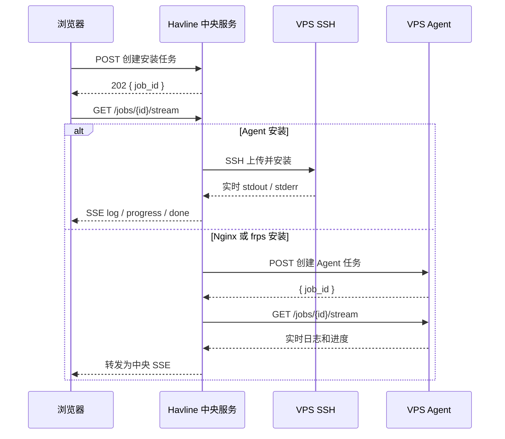

# Agent、Nginx、frps 安装日志与进度方案

## 1. 背景

当前在界面执行以下操作时，按钮只显示加载圈，用户无法判断任务处于哪个阶段：

- 安装或升级 Agent
- 安装 Nginx
- 安装或升级 frps

这些操作耗时较长，尤其是：

- SSH 上传 Agent 二进制
- `apt-get update` 与 `apt-get install nginx`
- 下载 frps 安装包
- 校验 SHA-256
- 解压 tar.gz
- 写入 systemd unit
- 启动或重启服务

用户目前只能在操作结束后看到最终输出，失败时也无法判断是网络、SSH、包管理器、下载还是 systemd 阶段的问题。

## 2. 当前实现分析

### 2.1 Agent 安装

调用链：

```text
AgentView.vue
  -> POST /api/frpmulti/servers/{id}/agent/install
  -> internal/api/frpmulti_handler.go
  -> Service.agentInstall
  -> AgentInstaller.Install
  -> SSHInstaller.Install
  -> uploadBytes + runSSHSession
```

特点：

- 安装确实通过 SSH 执行，不依赖 Agent 的 HTTPS 或隧道。
- `uploadBytes` 当前一次性写入二进制，没有上传进度。
- `runSSHSession` 使用 `session.Stdout` 和 `session.Stderr` 收集输出，但只在结束后返回。
- 前端 `run()` 只负责按钮 loading 和最终输出，没有实时事件通道。
- 安装输出里包含 `Token: ...`，如果直接展示日志，必须先脱敏。

### 2.2 Nginx 安装

调用链：

```text
ProxyRemoteView.vue
  -> POST /api/frpmulti/servers/{id}/agent/nginx/install
  -> Service.InstallAgentNginx
  -> AgentClient.InstallNginx
  -> Agent POST /api/v1/nginx/install
  -> Server.installNginx
```

特点：

- 真正的安装在 VPS Agent 进程内执行。
- 当前使用 `exec.CommandContext(...).CombinedOutput()`，命令结束后才能拿到输出。
- `apt-get update`、`dnf install`、`yum install`、`apk add` 都可能持续数分钟。
- Agent 的 HTTP 响应是一次性的，中间过程没有 job、SSE 或状态查询接口。

### 2.3 frps 安装

调用链：

```text
AgentView.vue
  -> POST /api/frpmulti/servers/{id}/agent/frps-install
  -> Service.InstallFRPSOnAgent
  -> AgentClient.InstallFRPS
  -> Agent POST /api/v1/frps/install
  -> Server.installFRPS
```

特点：

- `downloadToFile` 当前没有下载进度回调。
- SHA-256 校验、解压、写 unit、systemctl 重启都只在最终响应里返回 notes。
- 安装完成后，中央端还会继续下发 `frps.toml`，这一步也应该纳入任务日志。

### 2.4 现有可复用能力

项目已有两类进度模式：

1. 证书申请任务
   - `internal/acme/job.go`
   - `POST /api/certificates/apply` 返回 `job_id`
   - `GET /api/certificates/jobs/{id}/stream` 使用 SSE
   - 前端 `CertificatesView.vue` 使用 `EventSource`

2. FRP 客户端下载任务
   - `internal/frp/service.go` 的 `DownloadTask`
   - `GET /api/frpmulti/download/status`
   - 前端 `FrpView.vue` 每 500ms 轮询
   - 支持 `downloaded`、`total`、`message`、`status`

建议以 ACME 的 SSE 任务模型为主，以 FRP 下载的进度字段为补充，不新造第三套机制。

## 3. 方案目标

### 3.1 用户目标

- 点击安装后立即看到任务已经开始。
- 能看到当前阶段，例如“连接 SSH”“上传 Agent”“下载 frps”“校验安装包”“重启服务”。
- 能看到实时日志，而不是只看圈圈。
- 能区分“确定进度”和“不确定进度”。
- 失败时能定位到具体阶段和最后几行日志。
- 刷新页面或切换页面后，任务不丢，回来还能继续看。

### 3.2 工程目标

- 统一 Agent 安装、Nginx 安装、frps 安装的任务模型。
- 复用现有 SSE、认证、前端 EventSource 经验。
- 保持旧 Agent 兼容，不要求所有 VPS 同时升级。
- 日志必须脱敏，不能把 Agent Token 或 SSH 凭据输出到浏览器。
- 多服务器之间任务完全隔离。
- 同一服务器同一安装类型不允许并发执行。

## 4. 总体架构

### 4.1 两类执行域

需要明确区分：

```text
中央 Havline 服务
  -> 通过 SSH 执行 Agent 安装

VPS Agent
  -> 在 VPS 本机执行 Nginx 安装
  -> 在 VPS 本机执行 frps 安装
```

因此不能只做一套任务管理器：

- Agent 安装任务由中央服务管理。
- Nginx 和 frps 安装任务由 Agent 管理，中央服务负责桥接和转发。

### 4.2 数据流



### 4.3 为什么选择 SSE

推荐使用 SSE，而不是 WebSocket：

- 项目已有 SSE 实现和前端 EventSource 使用经验。
- 安装日志是单向流，不需要双向通信。
- 更容易通过 Nginx、隧道和现有代理。
- 断线后可以重新连接并回放快照。

轮询作为兼容兜底：

- 某些代理环境可能缓冲 SSE。
- 旧 Agent 不支持 SSE 时，中央服务可以轮询 Agent 任务状态。
- 前端 SSE 失败时，可以退化为轮询中央任务状态。

## 5. 统一任务模型

### 5.1 任务字段

建议新增共享任务结构：

```go
type OperationJob struct {
    ID         string
    ServerID   int64
    Kind       string
    Status     string
    Phase      string
    Message    string
    Current    int64
    Total      int64
    Percent    float64
    Error      string
    StartedAt  time.Time
    UpdatedAt  time.Time
    FinishedAt *time.Time
}
```

`Kind` 建议值：

```text
agent-install
nginx-install
frps-install
```

`Status` 建议值：

```text
queued
running
completed
failed
cancelled
```

`Phase` 建议值：

Agent 安装：

```text
prepare
ssh-connect
upload-agent
upload-script
install-agent
verify-agent
configure-transport
done
```

Nginx 安装：

```text
detect-package-manager
update-package-index
install-package
enable-service
probe-nginx
done
```

frps 安装：

```text
fetch-checksum
download-package
verify-checksum
extract-binary
write-systemd-unit
restart-service
push-config
probe-frps
done
```

### 5.2 SSE 事件

统一事件格式：

```json
{
  "type": "log",
  "job_id": "20261006-001",
  "kind": "nginx-install",
  "status": "running",
  "phase": "install-package",
  "level": "info",
  "message": "正在执行 apt-get install -y nginx",
  "current": 0,
  "total": 0,
  "percent": 0,
  "timestamp": "2026-10-06T10:00:00Z"
}
```

事件类型：

```text
snapshot   连接后先发送当前完整状态
phase      阶段变化
log        stdout / stderr 日志
progress   确定进度，例如下载字节数
done       任务完成
error      任务失败
heartbeat  心跳，防止代理断开
```

进度事件示例：

```json
{
  "type": "progress",
  "phase": "download-package",
  "message": "正在下载 frps 安装包",
  "current": 18350080,
  "total": 45613056,
  "percent": 40.2
}
```

不确定进度示例：

```json
{
  "type": "phase",
  "phase": "install-package",
  "message": "正在安装 Nginx，包管理器未提供可解析进度"
}
```

## 6. 中央服务设计

### 6.1 新增共享任务包

建议新增：

```text
internal/opjob/job.go
internal/opjob/manager.go
internal/opjob/sse.go
```

职责：

- 创建任务
- 保存事件快照
- 管理订阅者
- 发送 SSE
- 限制日志缓冲区
- 任务完成和过期清理

`internal/acme/job.go` 后续可以迁移到该包，避免重复维护。

### 6.2 中央任务管理器

任务管理器需要支持：

- `Create(serverID, kind)`
- `Get(jobID)`
- `Publish(jobID, event)`
- `Finish(jobID, result)`
- `Stream(ctx, jobID, writer)`
- `Latest(serverID, kind)`
- `CleanupExpired`

内存策略：

- 每个任务最多保留 500 到 1000 条日志事件。
- 超出后丢弃最旧日志，并插入“日志已截断”提示。
- 已完成任务保留 30 分钟。
- 服务重启后任务丢失，前端提示“任务记录已丢失，请重新执行”。

### 6.3 中央 API

推荐统一操作入口：

```http
POST /api/frpmulti/servers/{id}/operations
Content-Type: application/json

{
  "kind": "agent-install",
  "params": {
    "trust_new_host_key": false
  }
}
```

返回：

```json
{
  "job_id": "20261006-abc123",
  "status": "queued"
}
```

其他接口：

```http
GET /api/frpmulti/jobs/{jobID}
GET /api/frpmulti/jobs/{jobID}/stream
GET /api/frpmulti/servers/{id}/jobs/latest?kind=nginx-install
```

兼容策略：

- 保留现有同步安装接口一个版本周期。
- 新前端优先使用 `/operations` 和 SSE。
- 旧 Agent 不支持任务流时，中央任务使用兼容模式。

### 6.4 中央任务隔离

必须按 `server_id` 隔离：

- 任务查询校验 `server_id` 与当前登录会话权限。
- 任务流校验任务属于目标服务器。
- 同一服务器同一 `kind` 只允许一个运行中任务。
- 不同服务器可以并行安装，互不阻塞。
- 前端切换服务器时关闭旧 EventSource，重新连接新服务器任务。

## 7. Agent 侧任务设计

### 7.1 Agent 任务管理器

建议新增：

```text
internal/agent/jobs.go
internal/agent/job_handlers.go
```

Agent 任务接口：

```http
POST /api/v1/jobs/nginx/install
POST /api/v1/jobs/frps/install
GET  /api/v1/jobs/{id}
GET  /api/v1/jobs/{id}/stream
```

鉴权：

- 继续使用 Agent Token。
- 浏览器不直接连接 Agent SSE。
- 中央服务使用 `Authorization: Bearer <token>` 读取 Agent SSE。

### 7.2 Nginx 安装改造

当前：

```go
out, err := install.CombinedOutput()
```

改造为：

```go
stdout, _ := cmd.StdoutPipe()
stderr, _ := cmd.StderrPipe()
startStreamScanner(stdout, job.Log)
startStreamScanner(stderr, job.Log)
err := cmd.Run()
```

阶段：

1. `detect-package-manager`
2. `update-package-index`
3. `install-package`
4. `enable-service`
5. `probe-nginx`

进度策略：

- apt、dnf、yum、apk 的安装进度无法统一解析。
- 使用阶段进度，例如 0、15、45、75、90、100。
- UI 使用 indeterminate 进度条，同时显示实时日志。

### 7.3 frps 安装改造

当前：

```go
downloadToFile(downloadURL, tarball)
```

改造为：

```go
downloadToFileWithProgress(downloadURL, tarball, func(current, total int64) {
    job.Progress("download-package", current, total)
})
```

阶段和进度：

| 阶段 | 进度 | 说明 |
| --- | ---: | --- |
| fetch-checksum | 5% | 获取官方校验文件 |
| download-package | 5% 到 60% | 按字节数计算真实进度 |
| verify-checksum | 65% | 校验 SHA-256 |
| extract-binary | 75% | 解压 frps |
| write-systemd-unit | 85% | 写入或接管 unit |
| restart-service | 95% | systemctl enable/restart |
| push-config | 98% | 中央下发 frps.toml |
| probe-frps | 100% | 探测最终状态 |

### 7.4 Agent 并发控制

同一 Agent 上：

- Nginx 安装不能并发执行。
- frps 安装不能并发执行。
- 包管理器安装建议全局串行，避免 apt/dpkg 锁冲突。
- 下载任务可以独立，但最终写 unit 和重启服务要串行。

### 7.5 Agent 任务取消

建议 P1 实现：

```http
POST /api/v1/jobs/{id}/cancel
```

取消行为：

- 取消 context。
- 对 apt/dnf/yum/apk 使用进程组 kill。
- 保留已产生日志。
- 标记任务为 `cancelled`。

## 8. 中央桥接 Agent 任务

### 8.1 AgentClient 新方法

在 `internal/frp/agent_client.go` 增加：

```go
StartAgentJob(ctx, kind, payload) (string, error)
AgentJobSnapshot(ctx, jobID) (OperationJob, error)
StreamAgentJob(ctx, jobID, onEvent func(Event) error) error
```

注意：

- 现有 `AgentClient.http` 有 60 秒总超时，不适合 SSE。
- 新增无总超时的 `streamHTTP` client。
- SSE 读取使用 `bufio.Scanner`，设置最大行长度。
- 连接中断时自动重试快照或重新订阅。

### 8.2 中央任务执行器

```text
创建中央 job
  -> 启动 Agent job
  -> 订阅 Agent SSE
  -> 将 Agent 事件发布到中央 job
  -> Agent 完成
  -> 中央执行后续步骤
  -> 中央 job 完成
```

frps 的后续步骤：

```text
agent frps install done
  -> 生成 frps.toml
  -> 下发 frps.toml
  -> 探测 frps 状态
  -> 完成
```

### 8.3 旧 Agent 兼容

新增最低版本常量，例如：

```go
const agentMinVersionJobs = "0.16.0"
```

旧 Agent 处理：

- 中央检测到 Agent 不支持 `/api/v1/jobs/*`。
- 中央仍创建任务，但只发布阶段事件。
- 调用旧同步接口。
- 完成后发布最终日志和结果。
- UI 提示“当前 Agent 版本不支持实时日志，已使用兼容模式”。

## 9. 前端设计

### 9.1 新 composable

建议新增：

```text
web/src/composables/useOperationJob.ts
```

职责：

- 创建任务
- 建立 EventSource
- 维护任务状态
- 维护日志数组
- 自动重连
- 页面隐藏时暂停 UI 更新
- 组件卸载时关闭 EventSource

状态示例：

```ts
interface OperationJobState {
  jobId: string
  kind: string
  status: 'idle' | 'queued' | 'running' | 'completed' | 'failed' | 'cancelled'
  phase: string
  message: string
  percent: number
  current: number
  total: number
  logs: OperationLogLine[]
  error: string
  result?: Record<string, unknown>
}
```

### 9.2 新组件

建议新增：

```text
web/src/components/OperationProgressDrawer.vue
```

布局：

```text
标题：安装 Agent / 安装 Nginx / 安装 frps
状态：运行中 / 已完成 / 失败
阶段：准备 -> SSH -> 上传 -> 安装 -> 校验 -> 完成
进度条：确定进度或 indeterminate
日志框：实时 stdout / stderr
底部：复制日志、下载日志、取消、关闭
```

交互：

- 安装开始后自动打开抽屉。
- 日志自动滚动，用户手动上滚后暂停自动滚动。
- 失败时显示错误摘要和“查看完整日志”。
- 完成后显示最终结果，例如 Agent 版本、Nginx 路径、frps 版本。
- 关闭抽屉不取消任务。

### 9.3 页面接入

Agent 页面：

- “安装 Agent / 升级 Agent”改为创建 `agent-install` 任务。
- “安装 / 升级 frps”改为创建 `frps-install` 任务。

公网反代页面：

- “一键安装 Nginx”改为创建 `nginx-install` 任务。

现有 `opOutput`：

- 保留为历史摘要。
- 实时日志迁移到新抽屉。
- 完成后仍然写入历史摘要，方便回看。

### 9.4 页面刷新和切换

建议在浏览器保存最近一次任务：

```text
localStorage["havline:last-job:{serverID}:{kind}"] = jobID
```

页面加载时：

1. 读取最近 jobID。
2. 请求 `GET /api/frpmulti/jobs/{jobID}`。
3. 如果任务仍在运行，恢复日志面板。
4. 如果任务已完成或过期，清理记录。

服务端同时提供：

```http
GET /api/frpmulti/servers/{id}/jobs/latest?kind=agent-install
```

用于跨浏览器恢复。

## 10. 日志脱敏

这是本方案的安全硬要求。

### 10.1 必须脱敏的内容

- `Token: ...`
- `HAVLINE_AGENT_TOKEN=...`
- `Authorization: Bearer ...`
- SSH 密码
- 私钥内容
- 证书私钥
- 可能包含密码的命令行

### 10.2 脱敏位置

必须在以下位置之前脱敏：

- Agent 任务事件发送前
- 中央任务事件发送前
- SSE 写入前
- 历史日志保存前

不能只在前端隐藏，因为浏览器和日志接口仍可能看到明文。

### 10.3 示例

原始：

```text
Token: 8f3c2e...
```

输出：

```text
Token: ********
```

## 11. 性能与稳定性

### 11.1 日志节流

apt、dnf、systemctl 输出可能非常密集。

策略：

- 每 100ms 批量发送一次日志。
- 单条日志超过 4KB 时截断。
- 单任务最多保留 1000 条事件。
- 超出后丢弃旧日志并发送“日志已截断”。

### 11.2 SSE 心跳

- 每 15 秒发送一次 heartbeat。
- 避免 Nginx、隧道、浏览器代理因空闲断开。

### 11.3 背压

- 订阅通道使用有缓冲 channel。
- 慢订阅者不能阻塞任务执行。
- 状态、phase、done、error 事件必须可靠送达。
- 普通日志在缓冲满时可以丢弃并标记。

### 11.4 超时

建议：

| 操作 | 超时 |
| --- | ---: |
| Agent 安装 | 10 分钟 |
| Nginx 安装 | 10 分钟 |
| frps 安装 | 15 分钟 |
| SSE 空闲 | 不超时，使用 heartbeat |
| Agent SSE 重连 | 指数退避，最多 3 次 |

## 12. 错误处理

### 12.1 SSH 断开

- 任务标记失败。
- 保留已经收到的日志。
- 提示“SSH 连接中断，Agent 是否安装成功未知，请先点击探测环境”。

### 12.2 Agent 重启

- 中央连接 Agent SSE 时返回 404。
- 任务标记失败。
- 提示“Agent 已重启，任务状态丢失，请重新执行或探测当前状态”。

### 12.3 浏览器断开

- 任务继续执行。
- 浏览器重新连接后从 snapshot 开始回放。

### 12.4 中央服务重启

- 内存任务丢失。
- 前端收到任务不存在。
- 提示“任务记录已丢失，请重新执行或查看实际状态”。

## 13. 分阶段实施

### 阶段 1：统一任务基础设施

目标：

- 新增 `internal/opjob`。
- 实现 Job、Manager、SSE。
- 支持 snapshot、log、phase、progress、done、error、heartbeat。
- 增加单元测试。

不改用户可见行为。

### 阶段 2：Agent 安装实时日志

目标：

- 新增中央 `agent-install` 任务。
- SSH 上传、安装脚本输出实时推送。
- 前端新增 `OperationProgressDrawer`。
- Agent 页面接入。

这是收益最高、依赖最少的一步。

### 阶段 3：Nginx 安装实时日志

目标：

- Agent 增加 job 接口。
- `installNginx` 改造为流式执行。
- 中央桥接 Agent SSE。
- 公网反代页面接入。
- 旧 Agent 使用兼容模式。

### 阶段 4：frps 安装进度

目标：

- Agent frps 下载增加字节进度。
- 校验、解压、systemd、配置下发纳入任务阶段。
- Agent 页面接入。

### 阶段 5：任务恢复和取消

目标：

- 浏览器刷新恢复任务。
- 任务历史查询。
- 取消任务。
- 任务中心或统一历史面板。

### 阶段 6：持久化任务历史

可选：

- 将已完成任务摘要写入 SQLite。
- 支持按服务器、类型、时间筛选。
- 支持导出诊断包。

## 14. 文件影响清单

### 14.1 新增

```text
internal/opjob/job.go
internal/opjob/manager.go
internal/opjob/sse.go
internal/opjob/job_test.go
internal/opjob/sse_test.go
internal/agent/jobs.go
internal/agent/job_handlers.go
web/src/composables/useOperationJob.ts
web/src/composables/useOperationJob.spec.ts
web/src/components/OperationProgressDrawer.vue
```

### 14.2 修改

```text
internal/frp/ssh_installer.go
internal/frp/agent_installer.go
internal/frp/agent_client.go
internal/frp/service.go
internal/api/frpmulti_handler.go
internal/api/router.go
internal/agent/server.go
internal/agent/transport.go
web/src/api/client.ts
web/src/api/types.ts
web/src/views/AgentView.vue
web/src/views/ProxyRemoteView.vue
web/src/views/FrpView.vue
web/vite.config.ts
```

## 15. 测试计划

### 15.1 后端单元测试

- Job 快照回放。
- 多订阅者同时接收。
- done 后订阅自动结束。
- 日志缓冲区上限。
- SSE 心跳。
- 脱敏规则。
- 同一服务器同一任务并发拒绝。
- 不同服务器任务隔离。
- 旧 Agent 兼容回退。

### 15.2 后端集成测试

- 假 SSH 服务器返回多行输出，验证 Agent 安装事件顺序。
- 假 Agent 返回 SSE，验证中央桥接。
- frps 下载模拟慢速 reader，验证进度百分比。
- SSE 中途断开，验证重连和快照恢复。

### 15.3 前端测试

- `useOperationJob` 创建任务并连接 EventSource。
- snapshot、log、progress、done、error 状态更新。
- EventSource 重连。
- 组件卸载时关闭连接。
- 日志自动滚动与暂停。
- 安装按钮在任务运行中禁用。

### 15.4 手工验收

- 慢速 VPS 安装 Agent，能看到上传和安装日志。
- Ubuntu 安装 Nginx，能看到 apt 输出。
- CentOS 安装 Nginx，能看到 yum/dnf 输出。
- frps 下载慢时能看到百分比。
- 安装中途刷新页面，回来后仍能看到任务。
- 切换到另一台服务器，不会串台。
- 日志中没有 Token 和密码。

## 16. 验收标准

满足以下条件才算完成：

1. Agent 安装不再只显示圈圈，至少显示阶段和实时日志。
2. Nginx 安装能显示包管理器实时输出。
3. frps 安装能显示下载百分比、校验、解压和 systemctl 结果。
4. 安装失败时能指出失败阶段和最后错误。
5. 浏览器刷新或切换页面后，任务不丢。
6. 多服务器任务完全隔离。
7. 同一服务器同一安装类型不能重复并发。
8. Agent Token、SSH 凭据、私钥不会出现在日志中。
9. 旧 Agent 仍然可以安装 Nginx 和 frps，只是没有实时日志。
10. 后端、前端测试全部通过。

## 17. 推荐实施顺序

优先级从高到低：

1. 中央 `opjob` 任务基础设施。
2. Agent 安装实时日志。
3. 前端通用进度抽屉。
4. Agent 侧 Nginx job。
5. 中央桥接 Agent SSE。
6. frps 下载进度。
7. 任务恢复。
8. 任务取消。
9. 任务历史持久化。

先做第 1 到第 3 步，可以最快解决“只有圈圈”的核心体验问题，而且不需要先升级所有 VPS Agent。
