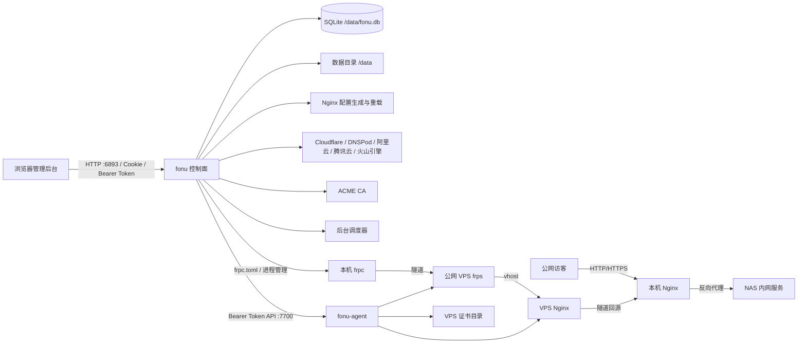

# Fonu 项目详细分析（v1.2.19）

> 分析日期：2026-09-27  
> 分析对象：`F:\Fonu-main\Fonu-1.0.2`  
> 代码版本：`VERSION = 1.2.19`，前端 `package.json = 1.2.19`，内置 Agent `0.12.7`  
> 分析方式：源码静态阅读、目录与依赖统计、迁移与路由核对、构建级验证  
> 验证结果：`go test ./... -count=1`、`go vet ./...`、`npm run typecheck`、`npm test` 均通过

---

## 一、结论摘要

Fonu 是面向飞牛 fnOS 和家庭 NAS 场景的「公网访问管理面板」。它把四类原本分散的运维能力收敛到一个 Go 单体和 Vue 管理后台中：

1. 本机 Nginx 反向代理与配置版本管理；
2. 多家 DNS 服务商的 DDNS 自动同步；
3. ACME 证书申请、续期、导入与下载；
4. 基于 FRP 的内网穿透，以及部署在公网 VPS 上的 `fonu-agent` 远程管理。

项目当前形态不是单纯 CRUD 面板，而是已经形成「本地控制面 + 公网 Agent + 定时任务 + SQLite 状态库 + Nginx 配置生成器」的完整运维系统。

主要优点：

- **模块边界较清楚**：`internal` 下按 `proxy`、`nginx`、`ddns`、`acme`、`frp`、`agent`、`monitor`、`backup` 等领域拆分，应用装配集中在 `internal/app/app.go`。
- **交付链路完整**：同一套源码可构建 Docker 镜像、Linux amd64/arm64 原生安装包，并内嵌双架构 `fonu-agent`。
- **关键配置具备回滚能力**：本机 Nginx 主配置、规则自定义配置，以及公网 Agent 上的 vhost 都有版本列表、差异和回滚入口。
- **自动化程度较高**：DDNS、证书续期、中国 IP 段更新、健康巡检、指标采样、自动备份均由调度器统一驱动。
- **测试基础设施已建立**：后端 90 个 Go 测试文件；前端已有 Vitest、TypeScript 严格模式与 CI 验证流程。

需要重点关注：

- **FRP 是系统复杂度中心**：`internal/frp` 约 6049 行，`internal/agent` 约 2079 行，二者共同承担 VPS 配置、进程、Nginx、证书、frps、诊断、版本与漂移检测，修改风险高于其他模块。
- **前端巨型组件明显**：`ProxyView.vue` 约 3150 行，`SettingsView.vue` 约 2144 行，`AgentView.vue` 约 1807 行，维护和样式隔离成本较高。
- **仍存在历史遗留接口引用**：前端保留 `/api/frp` 旧方法，`DdnsView.vue` 仍调用它，但后端当前只注册 `/api/frpmulti/*`；该调用落入 `catch`，会造成 DDNS 页的 FRP 提示状态始终为关闭。
- **初始管理员密码会进入系统日志**：`auth.EnsureDefaultAdmin` 将初始密码写入应用日志，日志中心的系统日志又会读取该文件，安全边界需要收紧。
- **仓库工作区有未提交改动**：当前有归档目录删除、内置 Agent 二进制更新、品牌图片更新等本地改动；分析时没有修改或回退这些内容。

---

## 二、仓库定位与目录边界

外层目录 `F:\Fonu-main` 不是项目源码仓库，而是工作区容器：

```text
F:\Fonu-main
├─ .breezell/                 工作区辅助目录
├─ .gocache-agent/            Agent 构建缓存
├─ docs/                      外层临时文档
├─ Fonu-1.0.2/                真正的 Git 仓库与源码根目录
├─ agent-tsc.log
├─ fonu-image-build4.log
└─ frps-m1-tsc.log
```

真正的 Git 仓库位于 `F:\Fonu-main\Fonu-1.0.2`：

- 当前分支：`main`
- 远端：`origin/main`
- 最近提交：`70b891c feat(scripts): 新增 upgrade-hub.sh，仅编排文件的部署可一条命令升级`
- 当前未提交内容：
  - 删除 `internal/frp-1.0.2/*`；
  - 删除 `web/src/views/FrpView-1.0.2.vue`；
  - 修改 `internal/frp/agentbin/fonu-agent-linux-amd64`；
  - 修改 `internal/frp/agentbin/fonu-agent-linux-arm64`；
  - 修改 `web/public/favicon.png`、`web/src/assets/brand/logo.png`；
  - 新增 `web/public/111favicon.png`、`web/src/assets/brand/logo00.png`。

项目主体目录：

| 目录 | 作用 |
| --- | --- |
| `cmd/fonu` | 本地控制面主程序入口，嵌入前端静态资源 |
| `cmd/fonu-agent` | 公网 VPS Agent 入口 |
| `internal` | 全部业务实现，共 29 个领域包 |
| `migrations` | SQLite 迁移，共 27 个 SQL 文件 |
| `web` | Vue 3 + Vite 管理后台 |
| `deploy` | Nginx MIME 类型等部署资源 |
| `scripts` | 原生安装、升级、Agent 安装和 Linux 打包脚本 |
| `docs` | 设计、审查、部署与 FRP 文档 |
| `.github/workflows` | CI、Docker 发布、GitHub Release |

---

## 三、总体架构



运行角色：

| 角色 | 运行位置 | 职责 |
| --- | --- | --- |
| `fonu` | NAS / Docker / 原生 Linux | 管理后台、本机 Nginx、DDNS、证书、frpc、调度器、数据持久化 |
| `fonu-agent` | 公网 VPS | 管理 VPS 上的 Nginx vhost、证书副本、frps 进程与配置，并提供诊断只读接口 |
| Nginx | NAS 与 VPS 两端 | NAS 侧负责反代与流量入口；VPS 侧负责公网反代和 frps vhost 回源 |
| frpc / frps | NAS / VPS | 在无公网 IP 时建立 TCP、HTTP、HTTPS 等隧道 |
| SQLite | NAS 数据目录 | 保存账号、会话、代理规则、DDNS、证书、FRP、指标、健康、备份元数据等 |

---

## 四、技术栈与构建交付

### 4.1 后端

`go.mod` 声明 Go 1.23，模块路径为 `github.com/fonu/fonu`。本次验证环境使用 Go 1.26.2，可正常构建与测试。

关键依赖：

| 能力 | 依赖 |
| --- | --- |
| HTTP 服务 | Go 标准库 `net/http` 与 `http.ServeMux` |
| SQLite | `modernc.org/sqlite`，纯 Go，不依赖 CGO |
| ACME | `github.com/go-acme/lego/v4` |
| DNSPod | `github.com/nrdcg/dnspod-go` |
| 腾讯云 | `tencentcloud-sdk-go` |
| 火山引擎 | `volcengine-go-sdk` |
| SSH | `golang.org/x/crypto/ssh` |
| 密码哈希 | `golang.org/x/crypto/bcrypt` |
| 日志轮转 | `gopkg.in/natefinch/lumberjack.v2` |

后端有两个入口：

- `cmd/fonu/main.go`：加载配置、解析迁移目录、嵌入 `web/dist`、启动 `app.New`、监听退出信号。
- `cmd/fonu-agent/main.go`：解析监听地址、Token、Nginx 目录、证书目录、frps 路径，启动 Agent HTTP 服务。

### 4.2 前端

前端使用 Vue 3.5、TypeScript 5.7、Vite 6：

| 能力 | 依赖 |
| --- | --- |
| UI 组件 | Naive UI |
| 路由 | Vue Router |
| 图表 | ECharts + vue-echarts |
| 配置编辑器 | CodeMirror 6 |
| 拖拽排序 | SortableJS |
| 图标 | `@vicons/ionicons5` |
| 测试 | Vitest |

`web/src` 共 52 个 TypeScript / Vue 源文件。前端测试目前有 2 个 spec、13 条测试，主要集中在格式化与状态映射纯函数。

### 4.3 Docker 与原生安装

项目提供三种 Compose：

| 文件 | 场景 | 网络 |
| --- | --- | --- |
| `docker-compose.yml` | 普通 Docker、本地源码构建 | bridge，映射 6893/18080/9443 |
| `docker-compose.host.yml` | 飞牛 fnOS 等已占用 80/443 的环境 | host 网络，默认反代端口 18080/9443 |
| `docker-compose.hub.yml` | 干净机器只保留一个编排文件 | BuildKit 直接从 Git 仓库拉源码构建 |

Dockerfile 的主要流程：

1. 从根目录 `VERSION` 读取版本；
2. 构建前端；
3. 交叉编译 Linux amd64 / arm64 `fonu-agent`；
4. 将前端 `dist` 复制到 `cmd/fonu/web/dist` 供 `go:embed`；
5. 编译 `fonu` 主程序；
6. 运行时镜像安装 Nginx、CA 证书、tzdata；
7. 默认监听 6893，暴露 80/443，数据目录为 `/data`。

注意：当前 Dockerfile 不预装 `frpc`，需要用户在「应用配置」中按需下载。旧版 README 或部署文档中若仍表述为“镜像内置 frpc”，应按当前实现校正。

### 4.4 版本一致性

当前版本事实：

| 位置 | 值 |
| --- | --- |
| `VERSION` | `1.2.19` |
| `web/package.json` | `1.2.19` |
| `AgentVersion` | `0.12.7` |
| `internal/version.Version` | 构建时通过 `-ldflags` 注入，默认 `dev` |

前端构建时优先读取 `VITE_APP_VERSION`，否则回落到 `package.json`。Dockerfile 将 `VERSION` 注入前端和后端。

---

## 五、后端模块分析

### 5.1 规模概览

后端共有 235 个 `.go` 文件，其中 90 个是 `_test.go`。按非测试源码粗略统计，主要模块规模如下：

| 包 | 文件数 | 约行数 | 职责 |
| --- | ---: | ---: | --- |
| `frp` | 23 | 6049 | FRP 多服务端、frpc 运行、Agent 调用、诊断、健康、漂移、版本 |
| `api` | 22 | 3241 | HTTP 路由、处理器、中间件、响应封装 |
| `ddns` | 14 | 2379 | 多服务商 DDNS、记录同步、凭证、Zone 解析 |
| `nginx` | 23 | 2186 | Nginx 配置生成、校验、启动、重载、版本与回滚 |
| `agent` | 4 | 2079 | 公网 VPS Agent 的全部接口与配置写入 |
| `notify` | 7 | 1418 | 通知配置、加密存储、邮件、Webhook、Telegram 与国内 IM |
| `acme` | 8 | 1370 | ACME 申请、续期、导入、导出、任务日志 |
| `proxy` | 3 | 1015 | 反代规则模型、SQLite Store 与端口冲突校验 |
| `service` | 3 | 595 | 反代与 Nginx 配置的业务服务层 |
| `monitor` | 1 | 559 | 资源、隧道、服务端、Agent、配置漂移巡检 |
| `logstore` | 4 | 685 | 系统日志、访问日志、错误日志读取与显示转换 |
| `traffic` | 3 | 421 | Nginx access log 跟踪、流量聚合、在线连接 |
| `backup` | 3 | 401 | 导出、恢复、校验、自动备份与保留策略 |
| `certificate` | 2 | 353 | 证书元数据 Store 与导入 |
| `auth` | 2 | 334 | 管理员、会话、API Token 验证 |
| `chinacidr` | 1 | 301 | 中国 IP 段下载、生成与 Nginx 联动 |
| `metrics` | 1 | 231 | 指标历史写入、查询与分桶 |
| `config` | 1 | 201 | 环境变量、数据目录、会话密钥 |
| `settings` | 1 | 193 | 设置项读写、默认值与类型转换 |
| `fsutil` | 1 | 164 | 原子写、备份、版本列表与回滚基础 |

### 5.2 应用装配：`internal/app/app.go`

`app.New` 是理解整个系统的入口，按顺序完成：

1. 创建日志目录与 JSON 日志；
2. 创建数据、Nginx、日志、证书、FRP 目录；
3. 解析或自动生成会话密钥；
4. 打开 SQLite 并执行迁移；
5. 创建 AES-GCM 凭据加密盒；
6. 初始化管理员账号；
7. 创建 proxy、settings、ddns、certificate、nginx 等 Store / Service；
8. 创建 FRP 多服务端服务；
9. 创建 HTTP 路由；
10. 创建调度器与流量采集器；
11. 启动 DDNS、ACME、中国 IP、巡检、自动备份任务；
12. 初始化 Nginx 配置并恢复 frpc 运行状态；
13. 启动 HTTP 服务，退出时关闭 Nginx、frpc 和数据库。

这种集中装配方式让依赖关系清晰，但也使 `app.go` 成为高耦合入口。新增模块时应继续通过构造参数或小型接口注入，避免在 `app.New` 中堆积具体职责。

### 5.3 配置与数据目录：`internal/config`

关键环境变量：

| 变量 | 默认值 | 说明 |
| --- | --- | --- |
| `FONU_LISTEN` | `:6893` | 管理后台监听地址 |
| `FONU_DATA_DIR` | `/data` 或当前目录 `.data` | 数据根目录 |
| `FONU_SESSION_SECRET` | 空 | 会话签名与凭据加密密钥；空时自动生成 |
| `FONU_NGINX_BIN` | `nginx` | Nginx 可执行文件 |
| `FONU_NGINX_PID` | `<DataDir>/nginx/nginx.pid` | Nginx PID |
| `FONU_NGINX_MIME_TYPES` | `/etc/nginx/mime.types` 或仓库资源 | MIME 类型文件 |
| `FONU_NGINX_HTTP_PORT` | `80` | 新建 HTTP 反代默认端口 |
| `FONU_NGINX_HTTPS_PORT` | `443` | 新建 HTTPS 反代默认端口 |
| `FONU_FRPC_BIN` | `frpc` | frpc 可执行文件 |
| `FONU_FRPC_PID` | `<DataDir>/frp/frpc.pid` | frpc PID 文件 |

会话密钥策略值得肯定：

- 显式配置时优先使用；
- 未配置时生成 32 字节随机值；
- 持久化为 `<DataDir>/session_secret`，权限 0600；
- 使用临时文件加改名写入，避免半文件；
- 已经使用历史默认值时只提示，不自动替换，避免历史密文全部无法解密。

数据目录典型结构：

```text
<DataDir>/
├─ fonu.db
├─ session_secret
├─ ssh_known_hosts
├─ nginx/
│  ├─ nginx.conf
│  ├─ rules/
│  ├─ custom/
│  ├─ backups/
│  ├─ errors/
│  └─ china_cidr.conf
├─ certs/
├─ frp/
│  ├─ frpc.toml
│  └─ frpc.pid
├─ logs/
│  ├─ app.log
│  ├─ access.log
│  ├─ error.log
│  └─ frpc.log
└─ backups/
```

### 5.4 数据库：`internal/db`

SQLite 初始化参数：

- `foreign_keys(1)`：启用外键；
- `busy_timeout(5000)`：锁等待 5 秒；
- `SetMaxOpenConns(1)`：单连接串行访问。

单连接是保守且适合 NAS 单机场景的选择，能避免多连接写冲突，但所有 API、调度任务和日志查询都共享一个数据库连接。当历史指标、健康事件和流量查询增大时，响应延迟可能互相影响。

迁移系统特点：

- 按文件名前缀数字排序；
- 每个迁移在独立事务中执行；
- 成功后写入 `schema_migrations`；
- 已应用版本跳过；
- 迁移文件不嵌入二进制，运行时通过 `ResolveMigrationsDir` 在多个候选路径查找。

### 5.5 认证与凭据

认证能力分三类：

1. 管理员账号：bcrypt 哈希；
2. 浏览器会话：32 字节随机 Token，数据库保存，默认 7 天；
3. API Token：随机明文只返回一次，数据库保存 SHA-256，支持 `read` / `write` 范围。

登录保护：

- 同一 IP 在 5 分钟内失败 5 次后返回 429；
- 登录失败会进入通知统计；
- 修改密码后删除该账号的其他会话，保留当前会话；
- Cookie 使用 `HttpOnly`、`SameSite=Lax`，并根据直连 TLS 或 `X-Forwarded-Proto` 设置 `Secure`。

凭据加密：

- 使用会话密钥经 SHA-256 派生 AES-256-GCM；
- 加密 DDNS、FRP、通知、SSH、Dashboard 和 OIDC 等敏感字段；
- 部分凭据 API 只返回 `has_token` / `has_password` 等状态，不回传明文。

---

## 六、数据库模型

### 6.1 表清单

| 表 | 迁移 | 作用 |
| --- | --- | --- |
| `schema_migrations` | 001 | 迁移版本 |
| `admins` | 001 | 管理员账号 |
| `sessions` | 001 | 浏览器会话 |
| `api_tokens` | 025 | API 脚本令牌 |
| `proxy_rules` | 001 / 006 / 010-014 | 本机反向代理规则 |
| `proxy_hosts` | 006 / 010 | 规则域名与监听端口 |
| `proxy_custom_endpoints` | 024 | 自定义 Nginx 规则解析出的域名端口占用 |
| `proxy_traffic` | 009 | 规则累计流量 |
| `ddns_configs` | 002-008 / 022 | DDNS 任务、记录、凭证、自定义 IP |
| `certificates` | 002 / 004 / 005 | 证书元数据、CA、多域名 |
| `settings` | 001 | 键值设置 |
| `frp_servers` | 015-016 / 020 / 023 | FRP 服务端、认证、Dashboard、Agent、SSH |
| `frp_proxies` | 015 / 018 / 021 | FRP 穿透规则与扩展选项 |
| `frp_runtime_status` | 015 / 019 | frpc 期望状态、进程状态、连接状态 |
| `frp_server_diagnostics` | 017 | 服务端延迟与可用性采样 |
| `route_health_events` | 026 | 公网规则状态变更事件 |
| `metrics_samples` | 027 | 本机与规则指标历史 |

### 6.2 数据设计亮点

- `proxy_hosts(hostname, listen_port)` 唯一，避免同一域名与端口被多条规则占用。
- `proxy_custom_endpoints` 单独记录自定义 Nginx 配置的监听端点，保证自定义模式也能参与冲突校验。
- `frp_proxies.type` 在 021 迁移中扩展到 8 种类型，并为 TCP / UDP 远程端口分别建立唯一索引。
- `frp_runtime_status` 将“用户期望状态”和“实际进程/连接状态”分开，有助于区分手动停止和异常掉线。
- `route_health_events` 只记录状态变化，不保存每轮原始采样，降低长期数据量。
- `metrics_samples` 采用 `(scope, metric, value, at)` 纵向结构，增加指标不需要改表。

### 6.3 数据生命周期

| 数据 | 清理方式 |
| --- | --- |
| 会话 | 校验过期时删除；修改密码时删除其他会话 |
| 健康事件 | 巡检按保留期清理 |
| 指标采样 | 巡检按保留期清理 |
| 备份归档 | 按设置中的保留份数剪枝 |
| Nginx 配置版本 | 默认保留最近 10 个有效变化 |
| 日志 | 由 `logstore` 与轮转策略处理 |

---

## 七、HTTP API 与认证面

### 7.1 路由规模

当前 `internal/api/router.go` 中：

- 受保护路由约 113 条：使用 `SessionMiddleware + RequireAuth`；
- 匿名路由 5 条：版本、登录状态、登录、退出、公开状态页；
- 静态资源与 SPA fallback：非 `/api/` 路由全部交给前端。

匿名接口：

| 方法 | 路径 | 说明 |
| --- | --- | --- |
| GET | `/api/version` | 版本与默认反代端口 |
| GET | `/api/auth/status` | 是否初始化、是否已登录 |
| POST | `/api/auth/login` | 登录 |
| POST | `/api/auth/logout` | 退出 |
| GET | `/api/status-page` | 默认关闭的只读状态页 |

### 7.2 API 分组

| 分组 | 代表路径 | 能力 |
| --- | --- | --- |
| 认证 | `/api/auth/*` | 登录、退出、改密 |
| API Token | `/api/settings/tokens` | 创建、列出、撤销 |
| 仪表盘 | `/api/status` | 公网 IP、DDNS、证书、反代、资源和请求趋势 |
| 本机反代 | `/api/proxies*` | 规则 CRUD、排序、流量、连接、实时日志 |
| Nginx 配置 | `/api/proxies/{id}/nginx`、`/api/settings/nginx/*` | 自动/自定义配置、校验、回滚、版本 |
| DDNS | `/api/ddns*` | 任务、测试、全部更新、单任务更新 |
| 证书 | `/api/certificates*` | CA 选项、申请、SSE 日志、导入、续期、下载、删除 |
| 设置 | `/api/settings` | 常规、通知、安全、高级设置 |
| 日志 | `/api/logs/*` | 访问、错误、系统、SSE |
| 指标 | `/api/metrics/history` | 分桶历史趋势 |
| 备份 | `/api/backup*` | 导出、恢复、归档、下载、删除 |
| 服务发现 | `/api/discovery/scan` | 扫描常见 NAS 服务端口 |
| FRP 多服务端 | `/api/frpmulti/*` | 服务端、frpc、规则、诊断、版本下载 |
| 公网 Agent | `/api/frpmulti/servers/{id}/agent/*` | 状态、Nginx、frps、证书、路由、漂移、指标 |

### 7.3 Agent API

`fonu-agent` 当前提供 20 个 `/api/v1/*` 接口，全部使用 Bearer Token：

| 类别 | 接口 |
| --- | --- |
| 基础 | `ping`、`status` |
| 路由 | 列表、写入、详情、删除、版本、回滚 |
| Nginx | 安装、重载、日志 |
| frps | 配置读取与写入、安装、启停重启 |
| 证书 | 写入与列表 |
| 中国 IP | `PUT /china-cidr` |
| 指标 | `GET /metrics` |

Agent 侧的重要安全措施：

- SSH 安装使用 TOFU 主机密钥校验，首次记录，后续变更拒绝；
- frps 下载只允许官方地址和固定加速前缀；
- frps 安装包下载后校验 SHA-256；
- Basic Auth 使用纯 Go apr1，不依赖 VPS 上的 `openssl`；
- 写 vhost 前保留版本，`nginx -t` 失败时恢复上一个可用配置。

---

## 八、前端结构

### 8.1 路由与页面

前端共 11 条路由定义：

| 路径 | 名称 | 是否公开 | 页面 |
| --- | --- | --- | --- |
| `/setup` | - | 重定向 | 跳转登录 |
| `/login` | `login` | 是 | 登录 |
| `/status` | `status` | 是 | 公开状态页 |
| `/dashboard` | `dashboard` | 否 | 仪表盘 |
| `/ddns` | `ddns` | 否 | DDNS |
| `/certificates` | `certificates` | 否 | 证书管理 |
| `/proxies` | `proxies` | 否 | 本机反向代理 |
| `/frp` | `frp` | 否 | 内网穿透 |
| `/frp-agent` | `frp-agent` | 否 | 公网服务端 |
| `/public-proxy` | `public-proxy` | 否 | 公网反代 |
| `/logs` | `logs` | 否 | 日志中心 |
| `/settings` | `settings` | 否 | 系统设置 |

路由守卫在每次受保护页面跳转前请求 `/api/auth/status`。公开状态页不做登录检查，避免匿名访问时产生无意义请求。

### 8.2 页面规模

| 文件 | 约行数 | 主要职责 |
| --- | ---: | --- |
| `ProxyView.vue` | 3150 | 本机反代规则、详情、日志、Nginx 配置 |
| `SettingsView.vue` | 2144 | 常规、通知、安全、高级、备份、Token |
| `AgentView.vue` | 1807 | 公网服务端、Agent、frps 生命周期、诊断 |
| `CertificatesView.vue` | 1685 | 证书列表、申请、续期、下载、导入 |
| `DashboardView.vue` | 1679 | 状态卡、趋势、健康、流量 |
| `DdnsView.vue` | 1568 | DDNS 任务、记录、服务商配置 |
| `FrpView.vue` | 1406 | frpc 服务端和穿透规则 |
| `ProxyRemoteView.vue` | 1150 | 公网反代部署、漂移、健康、版本 |
| `LogsView.vue` | 860 | 系统、访问、错误、FRP 日志 |

这些页面都由 Composition API 直接承载大量状态和逻辑。当前结构适合快速迭代，但需要继续拆分：

- `ProxyView.vue`：拆规则表单、Nginx 面板、客户端面板、日志面板；
- `AgentView.vue`：拆服务端表单、日志弹窗、详情弹窗、延迟图；
- `SettingsView.vue`：拆通知、安全、备份、Token、状态页卡片。

### 8.3 API 客户端

`web/src/api/client.ts` 统一处理：

- `credentials: include`；
- JSON 请求体；
- 30 秒普通请求超时；
- 10 分钟证书操作超时；
- 错误信息归一化；
- Blob 下载与文件名解析。

`web/src/api/types.ts` 约 923 行，集中定义后端响应结构。类型覆盖较全，但仍保留旧 FRP 单体接口类型，形成历史冗余。

### 8.4 前端测试

已有：

- `web/src/utils/status.spec.ts`：状态值到 UI 状态的映射回归；
- `web/src/utils/format.spec.ts`：格式化函数。

缺口：

- API 客户端无测试；
- 页面组件无测试；
- 轮询与可见性行为无测试；
- 配置差异、回滚、表单校验等高风险交互仍只能依赖类型检查与人工验证。

---

## 九、核心业务链路

### 9.1 本机反向代理

数据流：

```text
前端保存规则
  → proxy.Store 校验域名与端口唯一性
  → 写入 proxy_rules / proxy_hosts
  → 生成 Nginx 配置
  → nginx -t 校验
  → 热重载或重启
  → 写入流量采集与日志
```

要点：

- 规则支持多域名、多端口、IPv4/IPv6 监听、HTTPS 与 HTTP 跳转；
- 安全设置保存在 `security_json`，包括 IP 黑白名单、仅中国大陆、Basic Auth、限流、连接数限制、安全响应头等；
- 自动模式由模板生成，自定义模式允许编辑但会解析监听端点参与冲突校验；
- 配置写入前保留 `.bak` 与 `.versions`，失败不覆盖当前可用配置；
- Nginx 配置版本支持列表、读取、差异对比和回滚。

### 9.2 DDNS

支持的服务商：

- Cloudflare；
- DNSPod；
- 阿里云 DNS；
- 腾讯云 DNS；
- 火山引擎 DNS。

能力：

- 单任务多根域名 / 多记录；
- 最长后缀 Zone 匹配；
- IPv4 / IPv6；
- 自定义固定 IP；
- 手动测试与全部更新；
- 定时任务按设置间隔运行，默认 5 分钟；
- 凭证加密保存；
- IP 变化、失败等情况进入通知系统。

### 9.3 证书

证书链路：

```text
选择 CA 与域名
  → 复用 DDNS 凭证
  → DNS-01 挑战
  → lego 申请
  → 写入证书目录
  → 更新 certificates 表
  → 重载 Nginx
  → 前端通过 SSE 获取任务日志
```

当前 CA 相关能力：

- Let's Encrypt；
- ZeroSSL；
- LiteSSL；
- LiteSSL 强制 EAB；
- 可配置 DNS 递归解析器，避免容器内 `127.0.0.11` 无法解析权威 NS；
- 支持导入 PEM、下载 ZIP / 证书 / 私钥；
- 每天执行续期巡检，按到期阈值提醒。

### 9.4 FRP 与公网 Agent

FRP 模块当前支持：

- 多台公网 frps；
- 8 种穿透类型：tcp、udp、http、https、tcpmux、stcp、sudp、xtcp；
- frpc 多版本下载、启用与删除；
- frpc 配置生成与进程管理；
- frps.toml 同源生成；
- 服务端认证方式：token、none、OIDC；
- frpc 流量、连接数与速率；
- 服务端 TCP / 登录 / 代理 / DNS / 归属地诊断；
- SSH 一键安装、升级、卸载 `fonu-agent`；
- Agent 状态、Nginx、frps 配置、证书、日志、指标；
- 公网反代 vhost 部署、漂移检测、版本与回滚；
- 四段健康检查：DNS、证书、隧道、回源服务。

主要风险点：

- `internal/frp/service.go` 和 `internal/agent/server.go` 都是超大文件；
- 宿主机 Nginx 模板与 Agent Nginx 模板存在两份实现，需要人工保持同步；
- Agent 与主程序之间存在版本兼容契约，旧 Agent 通过 404/405 映射升级提示，但接口演进仍需谨慎；
- VPS 上的系统环境差异大，尤其是 Nginx 安装位置、systemd、宝塔环境与 PATH。

### 9.5 监控、健康与通知

调度器每 2 分钟执行 `monitor`：

- 本机 CPU、内存、磁盘；
- 资源阈值；
- 本机规则流量；
- 公网规则 DNS / 证书 / 隧道 / 服务四段健康；
- frps 服务端掉线；
- Agent 不可达；
- 公网 vhost 配置漂移。

通知渠道：

- SMTP 邮件；
- Webhook；
- Telegram；
- Bark；
- ntfy；
- Gotify；
- 企业微信；
- 钉钉；
- 飞书。

告警策略已具备：

- 连续失败阈值；
- 恢复通知；
- 资源告警冷却；
- 配置漂移冷却；
- 登录失败窗口统计。

### 9.6 指标、日志与流量

指标：

- 本机资源与每条公网规则流量写入 `metrics_samples`；
- 查询时按桶取平均，前端支持 1 小时、24 小时、7 天趋势；
- 避免每加一个指标就改表结构。

日志：

- `app.log`：应用系统日志；
- `access.log`：本机 Nginx 访问日志；
- `error.log`：本机 Nginx 错误日志；
- `frpc.log`：FRP 客户端日志；
- 日志中心支持分页、筛选和 SSE 实时访问/错误日志。

流量：

- `traffic.Collector` 跟踪 access log 增量；
- 汇总到规则和域名；
- 计算累计上下行、速率与当前连接数；
- 与监控巡检共用主机维度聚合算法，减少口径漂移。

### 9.7 备份与恢复

能力：

- 手动导出；
- 上传恢复；
- 定时自动备份；
- 服务端归档列表；
- 下载、恢复、删除；
- 恢复前校验归档；
- 按保留份数剪枝；
- 自动备份失败通知。

恢复会覆盖数据库与证书等关键数据，前端需要二次确认。由于 SQLite 正在运行，恢复后推荐重启 Fonu。

---

## 十、后台调度

`internal/app/app.go` 注册的任务：

| 任务 | 间隔 | 作用 |
| --- | --- | --- |
| DDNS | 默认 5 分钟，可在设置中调整 | 检测公网 IP 并同步 DNS |
| ACME | 24 小时 | 证书续期与到期提醒 |
| 中国 IP 段 | 默认 24 小时，可在设置中调整 | 下载并生成 Nginx geo 配置 |
| monitor | 2 分钟 | 资源、隧道、服务端、Agent、漂移巡检与指标采样 |
| backup | 24 小时 | 自动备份并按策略保留 |

调度器还负责：

- 任务 panic 恢复；
- 非正间隔跳过；
- 应用退出时通过 Context 取消。

---

## 十一、部署与运维

### 11.1 推荐部署形态

飞牛 fnOS 推荐：

```bash
docker run -d \
  --name fonu \
  --net=host \
  -v /vol1/docker/fonu-data:/data \
  --restart unless-stopped \
  fonu:local
```

管理入口 `http://<NAS-IP>:6893`，默认反代端口 18080/9443，避免和系统 Nginx 抢占 80/443。

### 11.2 升级方式

三种方式：

1. 本地源码：`docker compose up -d --build`；
2. 单文件编排：保留 `docker-compose.hub.yml`，重新执行 `docker compose up -d --build`；
3. 原生安装：使用 `scripts/build-linux.ps1` 构建包，再由 `scripts/fonu-install.sh` 安装。

升级脚本：

- `scripts/upgrade.sh`：拉代码、构建、重建、健康检查，支持 `--no-pull` 和回滚；
- `scripts/upgrade-hub.sh`：仅使用编排文件的部署升级；
- `scripts/agent-install.sh`：安装 `fonu-agent`。

### 11.3 数据持久化

默认使用命名卷 `fonu-data`。如需绑定宿主机目录，在 `.env` 中设置：

```dotenv
FONU_DATA_PATH=/vol1/docker/fonu-data
```

Compose 约定以 `/` 或 `.` 开头的值解释为 bind mount，其余字符串仍是命名卷。

`FONU_SESSION_SECRET` 同时承担凭据解密，已有数据后不能随意替换，否则 DDNS、FRP、通知和 SSH 等密文可能无法解密。

---

## 十二、工程化、测试与质量门禁

### 12.1 CI

`.github/workflows/ci.yml` 已实现完整验证顺序：

1. Checkout；
2. 安装 Node 22；
3. `npm ci`；
4. `npm run build`；
5. `npm test`；
6. 将 `web/dist` 同步到 `cmd/fonu/web/dist`；
7. 安装 Go；
8. `go vet ./...`；
9. `go test ./... -count=1`；
10. `go build ./...`。

顺序不可颠倒，因为 `cmd/fonu/main.go` 使用 `//go:embed all:web/dist`，干净检出时前端产物必须先生成。

当前 CI 尚未开启 `gofmt -l` 卡口，原因是仓库仍有历史未格式化文件。建议在集中执行一次 `gofmt -w` 后开启。

### 12.2 发布工作流

- `docker-release.yml`：tag 或手动触发，构建 amd64/arm64 镜像并生成多架构 manifest；
- `github-release.yml`：根据 `CHANGELOG.md` 生成 GitHub Release。

### 12.3 测试覆盖

Go 测试分布较广，`nginx` 包测试最多，其次为 `frp`、`acme`、`api`。

当前没有测试文件的包：

- `internal/discovery`；
- `internal/secret`；
- `internal/service`；
- `internal/settings`；
- `internal/version`；
- `cmd/fonu`；
- `cmd/fonu-agent`。

优先级较高的补测：

1. `internal/service` 的规则保存、Nginx 自定义配置与回滚；
2. `internal/settings` 的类型转换、默认值和迁移；
3. `internal/secret` 的加解密与密钥错误提示；
4. 路由与中间件测试，确保新增受保护接口不会漏鉴权；
5. Agent `readLimitState`、`writeLimitState` 与配置回滚；
6. 前端 API 客户端和轮询组合式函数。

### 12.4 本次验证

本次分析实际执行：

```bash
go test ./... -count=1
go vet ./...
cd web && npm run typecheck
cd web && npm test
```

结果：

- Go：所有含测试包通过；
- Go vet：无输出，退出码 0；
- 前端类型检查：通过；
- 前端测试：2 个测试文件、13 条测试全部通过。

### 12.5 格式化

仓库目前仍存在历史未格式化文件。本次只做过读取和测试，没有批量执行 `gofmt -w`，以免把格式化噪音混入用户当前未提交的改动。

---

## 十三、当前风险与技术债

### 13.1 功能与兼容性

1. **旧 `/api/frp` 客户端残留**
   - `web/src/api/client.ts` 仍定义 `getFRP`、`saveFRP`、`getFRPStatus`、`syncFRPDomains`、`getFRPLogs`；
   - `web/src/views/DdnsView.vue` 在 `init()` 中调用 `api.getFRP()`；
   - 后端当前只注册 `/api/frpmulti/*`，因此该请求失败后进入 `catch`，`frpEnabled` 被设为 `false`；
   - 影响：DDNS 页可能无法显示与 FRP 相关的提示；
   - 建议：删除旧类型与旧方法，或改为调用 `/api/frpmulti/status`。

2. **Agent 版本兼容需要长期维护**
   - 主程序通过 404/405 识别旧 Agent，并提示升级；
   - 新接口应继续沿用最低版本提示，避免前端只看到网络错误。

3. **宿主机与 Agent 的 Nginx 模板双份实现**
   - 一边是 `internal/nginx`，一边是 `internal/agent`；
   - 修改一处忘记另一处会造成本机与公网行为不一致；
   - 建议抽共享模板包，至少共享安全指令、限流、geo、WebSocket、TLS 片段。

### 13.2 安全

1. **初始管理员密码写入应用日志**
   - `auth.EnsureDefaultAdmin` 记录用户名和密码；
   - `logstore.appendSystemAttrs` 会把密码原样拼进系统日志；
   - `GET /api/logs/system` 可读取该系统日志；
   - 建议只在进程首次启动时输出到终端一次，不写入持久日志；或生成一次性初始密码文件并设置 0600。

2. **Agent 默认明文 HTTP 监听**
   - 默认 `:7700`，Bearer Token 直接在网络中传输；
   - 如果直接暴露公网，需要 HTTPS、内网限制或前置反向代理；
   - 建议默认绑定 `127.0.0.1`，由 Nginx 或隧道暴露，并把公网绑定作为显式选项。

3. **Agent Token 比较未使用常量时间**
   - Agent 使用字符串比较；
   - 建议使用 `crypto/subtle.ConstantTimeCompare`。

4. **Agent 限流状态反序列化失败会静默清空**
   - `readLimitState` 忽略 JSON 错误；
   - 后续写入可能删除 zone 文件；
   - 建议解析失败返回错误并保留原文件。

5. **备份上传仍允许 64MB**
   - 已有 `CreateTemp` 修复路径穿越；
   - 仍建议降低上限并增加频率限制。

### 13.3 性能与并发

1. **SQLite 单连接**
   - 当前实现简单可靠，但监控查询、日志、指标与 API 会竞争同一连接；
   - 可通过缩短事务、减少大查询、为高频读增加轻量缓存来缓解。

2. **前端大页面与高频轮询**
   - 多个页面存在 15 秒轮询，仪表盘流量轮询更快；
   - 轮询请求应加入 in-flight 互斥，并在页面隐藏时暂停；
   - 可以统一抽 `useVisibilityPolling`。

3. **巨型后端文件**
   - `internal/frp/service.go` 约 1805 行；
   - `internal/agent/server.go` 约 1551 行；
   - 建议按能力拆分文件，例如 rate limit、nginx template、frps install、route versions、diagnostics。

### 13.4 维护性

1. **前端样式与弹窗外壳重复**
   - 多个页面重复实现左列表、弹窗外壳和状态色；
   - 建议抽 `SidebarList.vue`、`ModalShell.vue` 和统一状态令牌。

2. **硬编码颜色仍需收敛**
   - `variables.css` 已有品牌令牌；
   - 页面中仍有大量直接色值与重复色板。

3. **旧文档时效**
   - `project-audit-2026-09-24.md` 基于 v1.2.6，其中很多 P0/P1 已实施；
   - 阅读旧审查时应以 CHANGELOG、当前源码和本文档为准。

4. **归档目录删除尚未提交**
   - `internal/frp-1.0.2` 与 `FrpView-1.0.2.vue` 在工作树中已删除但未提交；
   - 分析时保持原样，没有回退或提交。

---

## 十四、建议改进路线

### P0：先处理明确问题

1. 修正 `DdnsView` 对旧 `/api/frp` 的调用，切到 `/api/frpmulti/status`。
2. 初始管理员密码不再写入持久应用日志。
3. Agent Token 比较改为常量时间。
4. `readLimitState` 解析失败时拒绝覆盖原状态。
5. 明确 Agent 默认监听策略，最好默认仅本机或要求 HTTPS。

### P1：降低核心模块风险

1. 抽共享 Nginx 模板包，统一本机与 Agent 的安全、限流、geo、TLS 逻辑。
2. 拆分 `internal/frp/service.go` 与 `internal/agent/server.go`。
3. 拆分 `ProxyView.vue`、`SettingsView.vue`、`AgentView.vue`。
4. 为路由鉴权、配置回滚、Agent 版本兼容补测试。
5. 前端轮询统一抽 composable，加入互斥与页面可见性控制。

### P2：工程质量提升

1. 全仓执行一次 `gofmt -w`，随后在 CI 中开启 `gofmt -l` 卡口。
2. 清理旧 FRP 类型、旧 API 方法和未使用样式。
3. 收敛颜色令牌与重复弹窗外壳。
4. 增加前端 API 客户端测试与关键页面组件测试。
5. 为 SQLite 高频查询建立基准，确认单连接是否满足长期指标数据。

### P3：能力增强

1. 加密迁移包：导出并导入含敏感凭据的完整实例。
2. 审计日志：记录谁在何时修改了规则、服务端、证书和设置。
3. 2FA / TOTP 与登录设备管理。
4. SMART 磁盘健康与 UPS 状态。
5. Prometheus `/metrics` 导出。
6. 状态页事故记录与服务入口聚合页。

---

## 十五、关键源码索引

| 目标 | 文件 |
| --- | --- |
| 应用装配 | `internal/app/app.go` |
| 配置 | `internal/config/config.go` |
| 数据库迁移 | `internal/db/db.go`、`migrations/*.sql` |
| HTTP 路由 | `internal/api/router.go` |
| 认证中间件 | `internal/api/middleware.go` |
| 登录与会话 | `internal/auth/auth.go`、`internal/api/auth_handler.go` |
| 本机反代 | `internal/proxy/proxy.go`、`internal/service/nginx_config.go` |
| Nginx 生成与重载 | `internal/nginx/*.go` |
| DDNS | `internal/ddns/*.go` |
| 证书 | `internal/acme/*.go`、`internal/certificate/*.go` |
| FRP 主服务 | `internal/frp/service.go` |
| FRP 模型 | `internal/frp/model.go` |
| Agent 客户端 | `internal/frp/agent_client.go` |
| 公网 Agent | `internal/agent/server.go`、`internal/agent/versions.go` |
| 监控巡检 | `internal/monitor/monitor.go` |
| 通知 | `internal/notify/*.go` |
| 日志 | `internal/logstore/*.go` |
| 流量 | `internal/traffic/collector.go` |
| 指标 | `internal/metrics/*.go` |
| 备份 | `internal/backup/*.go` |
| 前端路由 | `web/src/router/index.ts` |
| 前端 API | `web/src/api/client.ts`、`web/src/api/types.ts` |
| 前端布局 | `web/src/layouts/AppLayout.vue` |
| CI | `.github/workflows/ci.yml` |
| 容器构建 | `Dockerfile`、`docker-compose*.yml` |

---

## 十六、总结

Fonu 已经从一个 Nginx 反代面板发展为覆盖「本地入口、DNS、证书、内网穿透、公网 Agent、监控告警、备份恢复」的 NAS 公网访问控制面。

它的优势在于：功能完整、模块边界总体清楚、迁移与部署链路成熟、关键配置有版本和回滚、自动化任务覆盖主要运维场景。

当前最需要做的不是继续横向增加功能，而是先把 FRP / Agent 这条最复杂的链路拆小，把旧接口残留和日志泄密等明确问题清掉，再补上路由鉴权、配置回滚和 Agent 兼容测试。这样后续增加迁移包、审计、2FA、Prometheus 等能力时，才不会把复杂度继续堆进两个超大服务文件。
