# Havline 图文操作手册

> 适用版本：Havline 1.9.x
> 适用部署：Docker 版与 Native 飞牛版
> 截图目录：`docs/screenshots/`
> 说明：截图中的 IP、域名和状态仅用于演示，请以实际环境为准。

## 目录

1. 快速开始
2. 仪表盘
3. DDNS
4. 证书管理
5. 反向代理
6. 内网穿透（FRP）
7. 公网服务端（Agent）
8. 公网反代
9. Cloudflare 隧道
10. 日志中心
11. 系统设置
12. 关于项目
13. 公开状态页
14. 常见操作流程
15. 故障排查
16. 安全建议

## 一、快速开始

### 1.1 登录管理后台

打开 Havline 地址：

```text
http://<NAS-IP>:6893
```

飞牛 Native 版通过统一网关访问：

```text
https://<飞牛访问域名>/app/havline
```

首次登录使用安装向导中设置的管理员密码。登录后建议立即到
「系统设置 → 安全 → 管理员账户」修改密码。

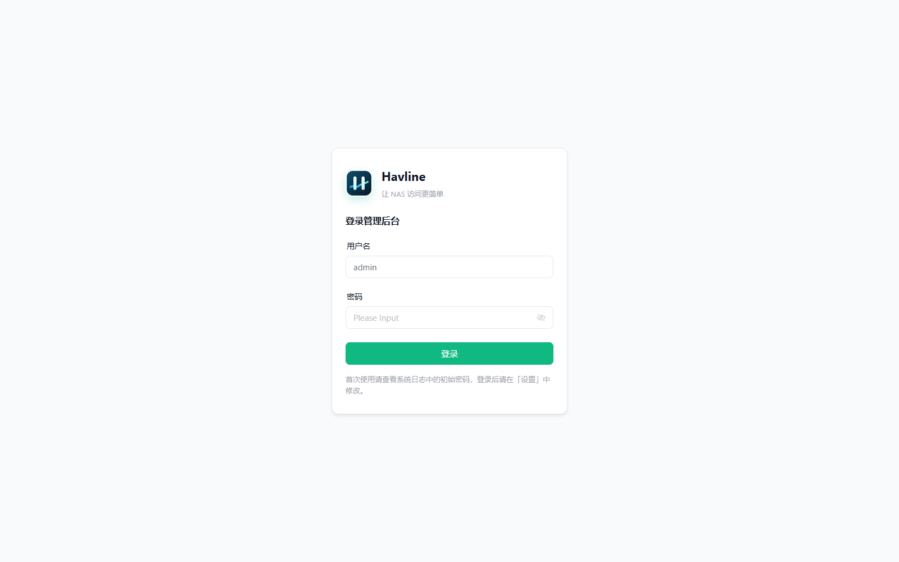

操作流程：

1. 输入用户名，默认是 `admin`。
2. 输入管理员密码。
3. 点击「登录」。
4. 登录成功后自动进入「仪表盘」。

注意事项：

- Docker 版默认管理端口是 `6893`。
- Native 版优先使用统一网关入口 `/app/havline`。
- 如果忘记密码，需要进入数据目录处理数据库，建议提前做好备份。

### 1.2 页面导航

左侧菜单按使用频率排列：

```text
仪表盘
DDNS
证书管理
反向代理
内网穿透
公网服务端
公网反代
Cloudflare 隧道
日志中心
系统设置
关于项目
```

页面总览：

| 页面 | 路径 | 主要用途 |
| --- | --- | --- |
| 仪表盘 | `/dashboard` | 查看运行状态、流量、资源和异常 |
| DDNS | `/ddns` | 自动同步公网 IP 到 DNS |
| 证书管理 | `/certificates` | 申请、导入、续签和删除证书 |
| 反向代理 | `/proxies` | 管理域名到内网服务的反向代理 |
| 内网穿透 | `/frp` | 管理 frpc 和穿透规则 |
| 公网服务端 | `/frp-agent` | 管理 VPS 上的 Agent 与 frps |
| 公网反代 | `/public-proxy` | 把穿透规则发布到 VPS Nginx |
| Cloudflare 隧道 | `/cloudflare` | 管理 Cloudflare Tunnel |
| 日志中心 | `/logs` | 查看系统、访问和错误日志 |
| 系统设置 | `/settings` | 配置主题、通知、备份、安全和令牌 |
| 关于项目 | `/about` | 查看版本、来源和开源许可 |

## 二、仪表盘

仪表盘用于快速判断 Havline 是否健康，以及当前公网访问是否正常。

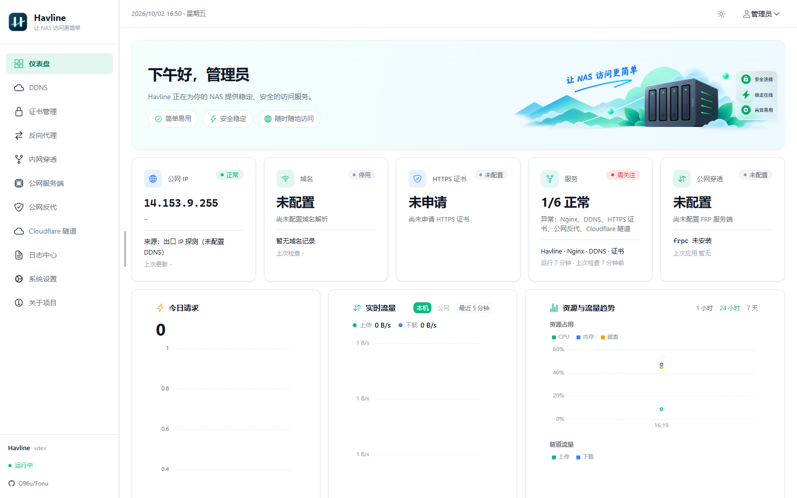

### 2.1 状态卡片

顶部有五张核心状态卡：

| 卡片 | 说明 |
| --- | --- |
| 公网 IP | 当前检测到的公网 IPv4/IPv6 和来源 |
| 域名 | DDNS 域名配置与最近同步状态 |
| HTTPS 证书 | 证书数量、到期状态 |
| 服务 | Havline、Nginx、DDNS、证书等核心服务聚合状态 |
| 公网穿透 | frpc 是否安装、是否连接、启用规则数 |

操作：

1. 点击卡片可以跳转到对应页面。
2. 状态显示「正常」「停用」「未配置」「需关注」时，按提示进入对应页面处理。
3. 「服务」卡会点名异常项，例如 Nginx、DDNS、HTTPS 证书、公网反代或 Cloudflare 隧道。

### 2.2 今日请求与实时流量

「今日请求」显示当天访问次数和异常请求占比。

「实时流量」支持切换数据源：

```text
本机：Havline 管理的本机 Nginx
公网：VPS frps 侧逐规则计数
```

操作：

1. 点击「本机 / 公网」切换数据源。
2. 查看上传和下载速率。
3. 查看「流量 Top」列表，定位流量最大的规则。

### 2.3 资源与流量趋势

可以切换时间范围：

```text
1 小时
24 小时
7 天
```

图表包含：

- CPU 占用；
- 内存占用；
- 磁盘占用；
- 上传和下载流量趋势。

### 2.4 最近请求和系统日志

页面下方展示最近访问记录和系统日志。

操作：

1. 查看状态码、路径、耗时和来源。
2. 状态码大于等于 400 的请求需要重点关注。
3. 点击「日志中心」查看完整日志。

## 三、DDNS

DDNS 用于把动态公网 IP 自动同步到 DNS 解析。

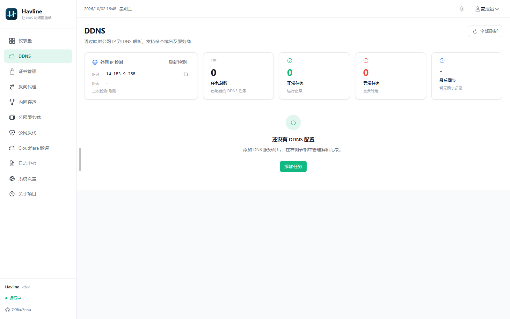

### 3.1 添加 DDNS 任务

操作流程：

1. 点击「添加任务」。
2. 选择 DNS 服务商，例如阿里云、腾讯云、DNSPod、Cloudflare、火山引擎。
3. 填写服务商凭证。
4. 点击「测试连接」确认凭证可用。
5. 保存服务商。
6. 在右侧「解析记录」区域点击「添加记录」。
7. 填写完整域名，例如：

```text
nas.example.com
www.example.com
api.example.com
```

8. 保存记录。
9. 点击「立即同步」验证解析是否更新。

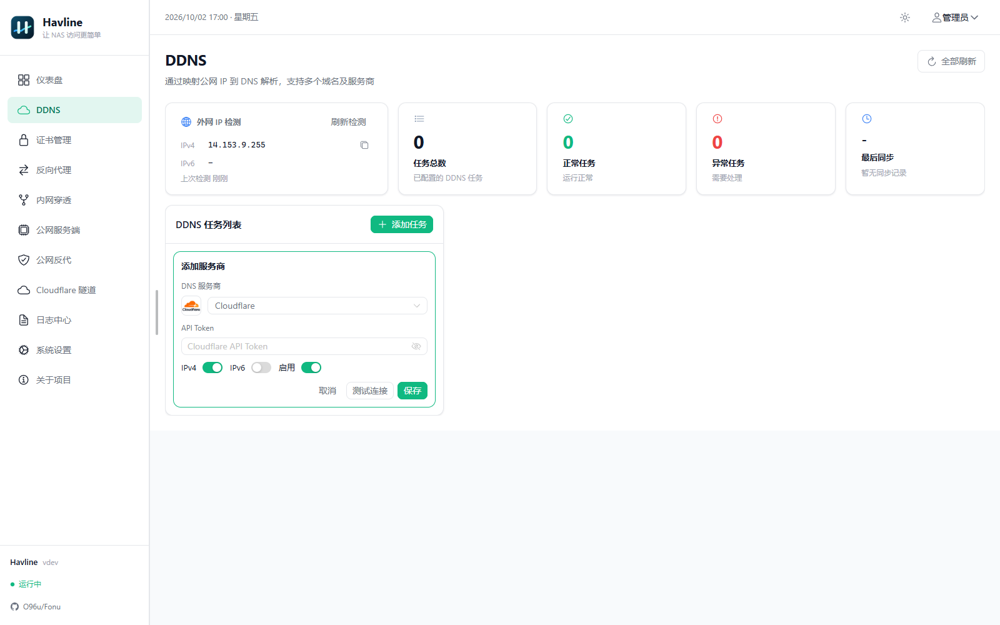

弹窗字段说明：

- DNS 服务商：选择阿里云、腾讯云、DNSPod、Cloudflare、火山引擎等。
- API Token / AccessKey：填写对应服务商的 API 凭证。
- 测试连接：先验证凭证是否有效，再保存。
- 保存：保存后弹窗关闭，任务出现在左侧列表。
- 解析记录：保存服务商后，在右侧点击「添加记录」填写完整域名。

### 3.2 同步周期

「同步周期」决定 Havline 多久检查一次公网 IP。

操作：

1. 修改同步周期。
2. 点击「保存」。
3. 观察「最后同步」时间。

### 3.3 全部刷新

点击右上角「全部刷新」会依次更新所有已启用的 DDNS 任务。

结果可能是：

```text
全部更新成功
部分域名同步失败
部分任务更新失败
```

### 3.4 自定义 IP

适用于公网 IP 不由本机出口决定的场景。

操作：

1. 选中一个 DDNS 任务。
2. 点击「自定义 IP」。
3. 填写公网 IPv4 或 IPv6。
4. 保存。

填写自定义 IP 后，DDNS 更新会直接使用该 IP，不再检测本机出口 IP。

### 3.5 删除任务或记录

操作：

1. 选中任务或记录。
2. 点击「删除」。
3. 确认删除。

注意事项：

- 删除 DDNS 任务会移除对应服务商配置。
- 删除解析记录不会删除 DNS 服务商上的域名，只是不再由 Havline 管理。

## 四、证书管理

证书管理用于申请、导入、续签和删除 HTTPS 证书。

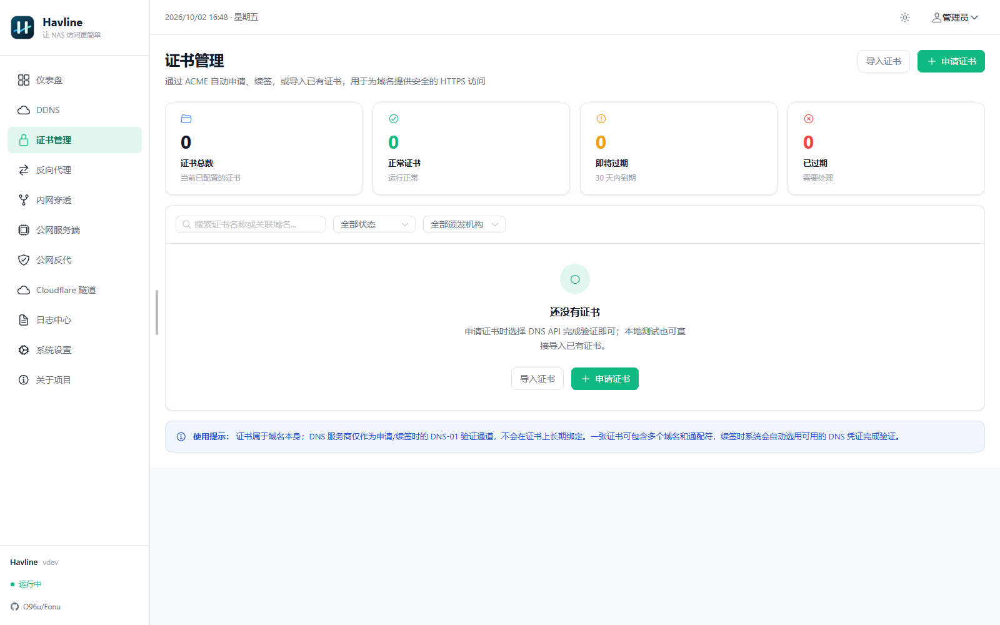

### 4.1 申请证书

操作流程：

1. 点击「申请证书」。
2. 填写证书名称，例如 `example`。
3. 填写域名，一行一个：

```text
example.com
*.example.com
api.example.com
```

4. 选择颁发机构，例如 Let's Encrypt、ZeroSSL、LiteSSL。
5. 填写 ACME 邮箱。
6. 选择 DNS 验证任务。
7. 点击「下一步」。
8. 确认信息后开始申请。
9. 等待申请完成，成功后证书会出现在列表。

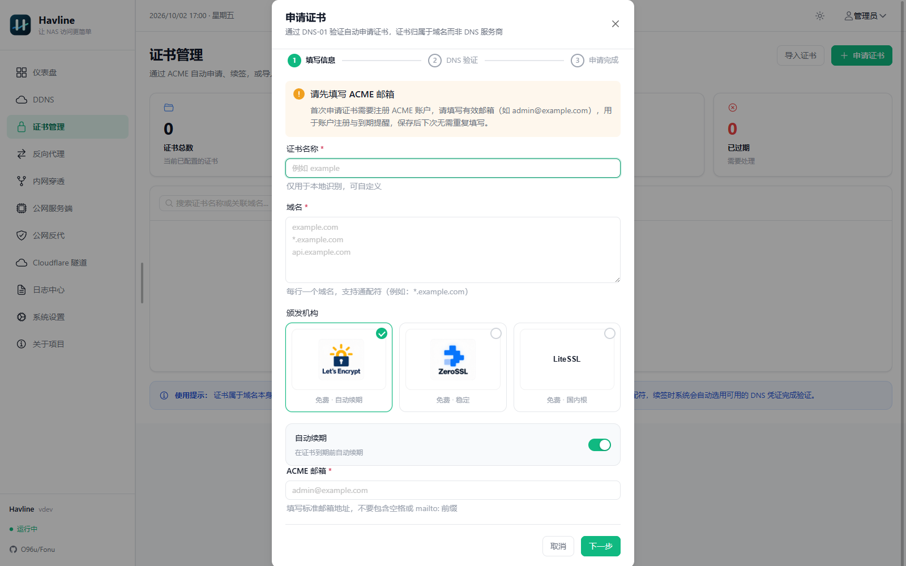

弹窗操作顺序：

1. 点击「申请证书」打开弹窗。
2. 填写证书名称。
3. 填写域名，一行一个。
4. 选择颁发机构。
5. 填写 ACME 邮箱。
6. 选择 DNS 验证任务。
7. 点击「下一步」。
8. 确认信息后开始申请。
9. 申请完成后关闭弹窗。

注意事项：

- 使用 DNS-01 验证时，需要先在 DDNS 页面添加并启用 DNS 任务。
- 泛域名证书必须使用 DNS-01 验证。
- ZeroSSL 需要 API Key。
- LiteSSL 需要 EAB Kid 和 HMAC。

### 4.2 导入证书

操作流程：

1. 点击「导入证书」。
2. 选择导入方式：

```text
粘贴 PEM 内容
从本机文件读取
填写服务器文件路径
```

3. 填写证书和私钥。
4. 点击「导入」。

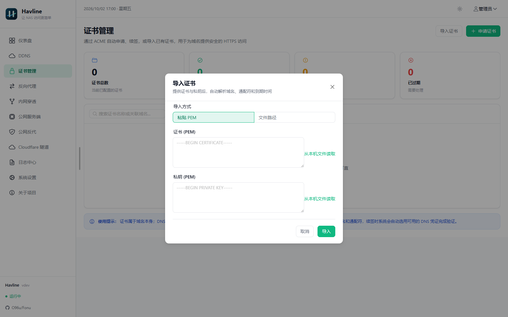

导入方式：

- 粘贴 PEM 内容；
- 从本机文件读取；
- 填写服务器文件路径。

### 4.3 下载证书

在证书列表操作列中选择：

```text
下载 ZIP
下载证书
下载私钥
```

### 4.4 续签证书

操作：

1. 找到需要续签的证书。
2. 点击「续签」。
3. 等待续签完成。

注意事项：

- 手动导入的证书不能自动续签，需要重新导入。
- 自动续签检查天数在「系统设置 → 自动任务」中配置。

### 4.5 删除证书

操作：

1. 点击证书操作列中的「删除」。
2. 确认删除。

删除后，使用该证书的 HTTPS 反向代理可能失效。

## 五、反向代理

反向代理用于把域名映射到 NAS 或局域网内的服务。

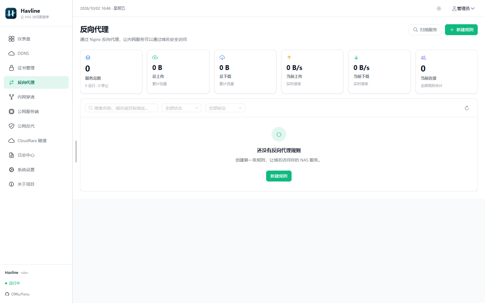

### 5.1 新建规则

操作流程：

1. 点击「新建规则」。
2. 填写名称，例如 `nas-web`。
3. 填写域名，一行一个：

```text
nas.example.com
example.com:6893
```

4. 填写目标地址，例如：

```text
http://192.168.1.100:5173
https://192.168.1.100:8443
```

5. 选择出口：

```text
本机 Nginx
Cloudflare 隧道
```

6. 按需启用 HTTPS。
7. 按需启用规则。
8. 点击「创建」。

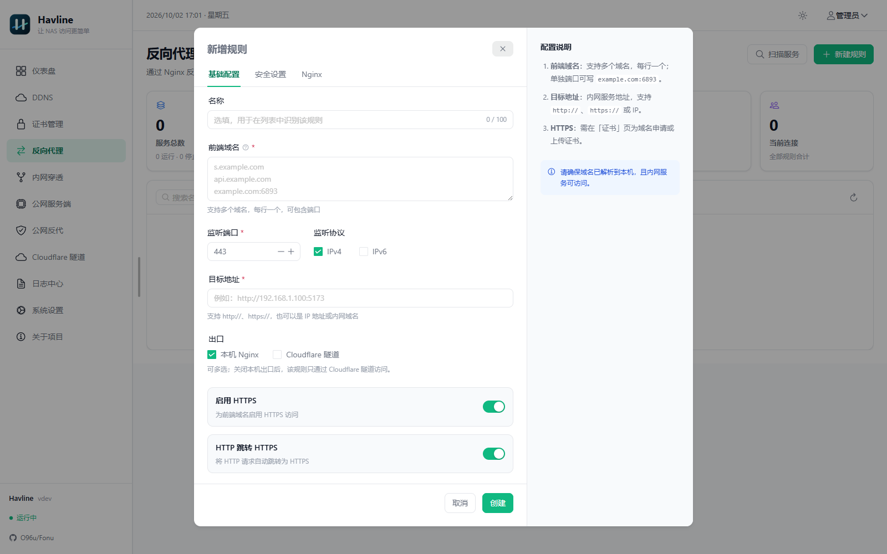

弹窗填写顺序：

1. 填写名称。
2. 填写域名，一行一个。
3. 填写目标地址，例如 `http://192.168.1.100:5173`。
4. 选择出口。
5. 配置 HTTPS。
6. 配置安全策略。
7. 点击「创建」。

### 5.2 发现本机服务

操作：

1. 点击「扫描本机服务」。
2. 在弹窗中查看检测到的服务。
3. 点击「发布」自动填入目标地址。
4. 补充域名后保存。

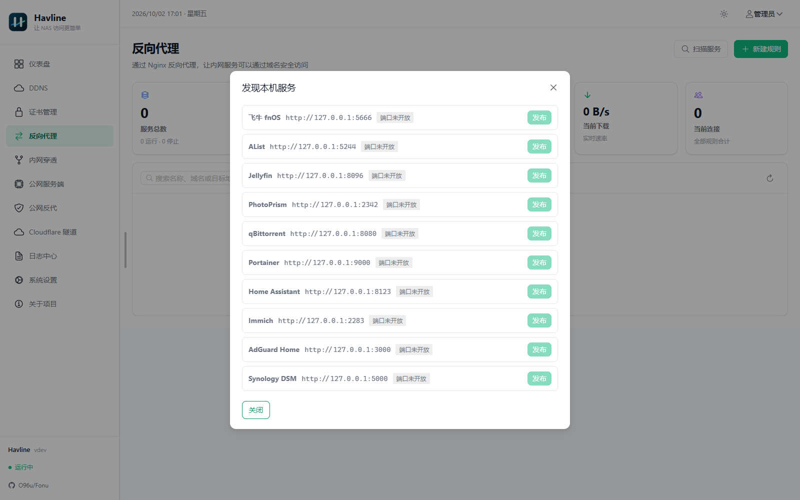

弹窗操作：

1. 点击「扫描服务」。
2. 查看检测到的服务列表。
3. 点击「发布」。
4. 弹窗关闭后补充域名并保存规则。

### 5.3 搜索和筛选

支持按以下条件筛选：

```text
名称、域名或目标地址
状态
协议
```

### 5.4 启用、停用、编辑、复制和删除

操作：

1. 在规则列表中点击状态开关启用或停用规则。
2. 点击「编辑」修改规则。
3. 点击「复制」基于现有规则创建新规则。
4. 点击「删除」移除规则。
5. 拖拽规则可以调整顺序。

### 5.5 规则详情

点击规则进入详情页，可以查看：

- 域名和端口；
- 目标地址；
- 安全策略；
- 连接客户端；
- 实时访问日志；
- Nginx 配置。

### 5.6 Nginx 配置

规则支持自动生成和手动编辑。

操作：

1. 打开规则详情。
2. 切换到「Nginx 配置」。
3. 查看自动生成的配置。
4. 如需手动编辑，点击「手动编辑」。
5. 保存前会自动备份。
6. 失败时可以点击「回滚」或「恢复自动生成」。

### 5.7 安全策略

安全策略包含：

```text
IP 黑名单
IP 白名单
Basic Auth
每秒请求数
突发上限
最大连接数
安全响应头
TLS 1.3
```

操作：

1. 打开规则编辑弹窗。
2. 切换到「安全」。
3. 按需启用策略。
4. 保存规则。

建议：

- 管理类服务建议同时启用 IP 白名单和 Basic Auth。
- 公开 Web 服务建议启用限流和安全响应头。
- 开启 HTTPS 后再启用 TLS 1.3。

## 六、内网穿透（FRP）

内网穿透用于在 NAS 没有公网 IP 时，通过 VPS 的 frps 暴露服务。

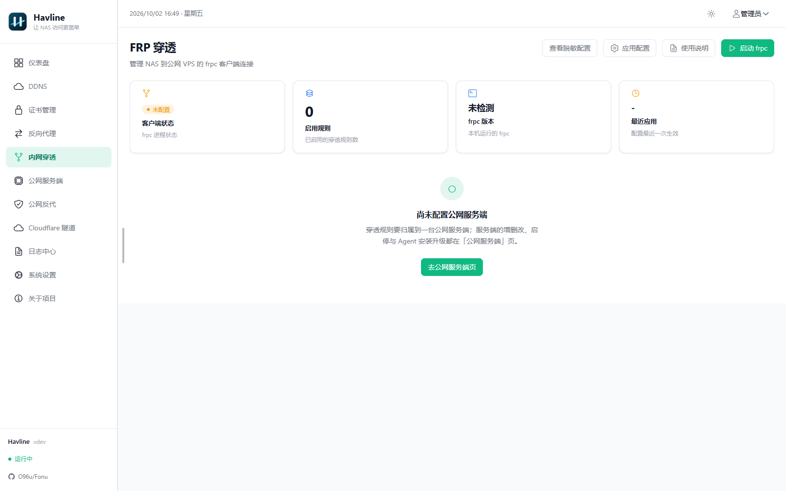

### 6.1 前置条件

需要：

1. 一台有公网 IP 的 VPS。
2. VPS 上运行 frps。
3. Havline 中配置对应 FRP 服务端。
4. 下载并启用 frpc。

### 6.2 应用配置和 frpc 版本

操作：

1. 点击右上角「应用配置」。
2. 查看系统架构、当前 frpc 和配置文件。
3. 选择下载加速代理。
4. 在「FRP 官方下载」中选择版本。
5. 点击「下载」。
6. 下载完成后点击「启用」。

也可以删除不再使用的 frpc 版本。

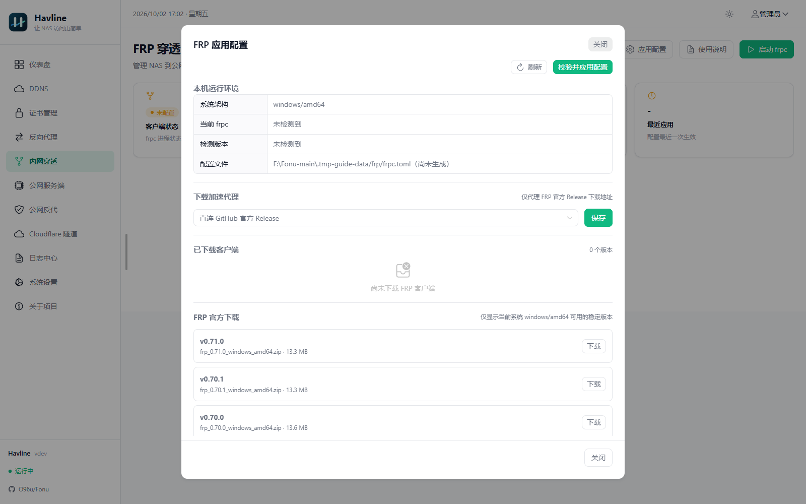

弹窗操作顺序：

1. 点击「应用配置」。
2. 查看系统架构和当前 frpc。
3. 选择下载加速代理。
4. 在 FRP 官方下载列表中选择版本。
5. 点击「下载」。
6. 下载完成后点击「启用」。
7. 关闭弹窗，点击「启动 frpc」。

### 6.3 启动和停止 frpc

操作：

1. 点击「启动 frpc」。
2. 状态卡变为运行中。
3. 需要维护时点击「停止 frpc」。

### 6.4 添加穿透规则

操作流程：

1. 点击「添加规则」。
2. 选择公网服务端。
3. 填写规则名称。
4. 选择类型：

```text
tcp
udp
http
https
tcpmux
stcp
sudp
xtcp
```

5. 填写内网地址和端口。
6. 根据类型填写远程端口或自定义域名。
7. 按需配置传输、健康检查、负载均衡、请求头、插件和 NAT 穿透。
8. 保存规则。

### 6.5 规则详情和日志

操作：

1. 点击规则进入详情。
2. 查看连接数、实时流量和累计流量。
3. 切换到「日志」查看该规则相关日志。
4. 点击「刷新」获取最新日志。

### 6.6 查看脱敏配置

点击「查看脱敏配置」可以查看当前启用的 frpc 配置，敏感字段会被脱敏。

### 6.7 服务端诊断

在服务端详情中可以查看：

- TCP 可达性；
- frpc 登录状态；
- 代理可达性；
- DNS 解析；
- 归属地；
- 可用率和延迟曲线。

## 七、公网服务端（Agent）

公网服务端页面用于管理 VPS 上的 `havline-agent` 和 `frps`。

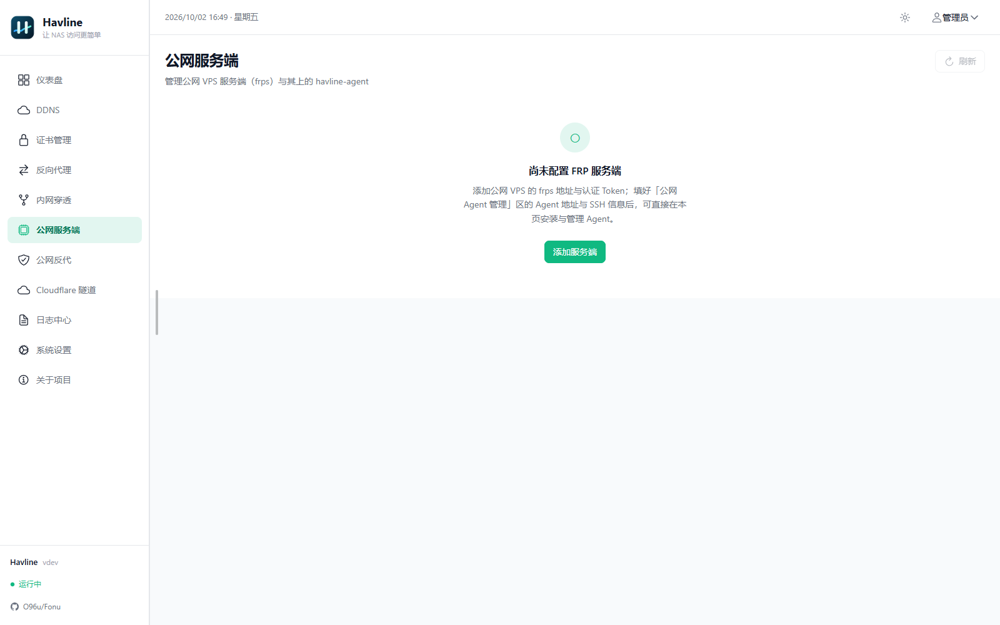

### 7.1 添加服务端

操作流程：

1. 点击「添加服务端」。
2. 填写 VPS 地址和 SSH 信息。
3. 填写 FRP 端口和认证 Token。
4. 可选填写 frps 管理接口。
5. 保存。

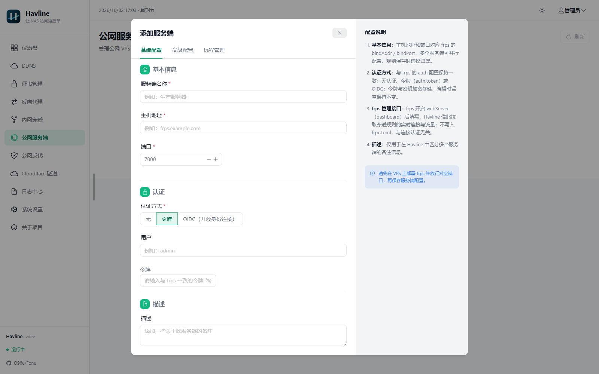

弹窗字段说明：

- 服务端名称：用于识别 VPS。
- 主机地址：frps 的地址。
- 端口：frps 的 bindPort。
- 认证方式：无认证、Token 或 OIDC。
- Token：与 frps 的 `auth.token` 保持一致。
- Agent 地址与 SSH 信息：用于安装和管理 Agent。
- 保存：保存后进入服务端详情。

### 7.2 安装 Agent

操作：

1. 打开服务端详情。
2. 进入「公网 Agent 管理」。
3. 点击「安装 Agent」。
4. 等待安装完成。
5. 点击「测试连接」确认 Agent 在线。

### 7.3 Agent 状态和证书

可以查看：

- Agent 版本；
- Nginx 状态；
- frps 状态；
- 证书列表；
- Agent 证书有效期；
- 路由部署状态。

### 7.4 frps 配置

操作：

1. 打开服务端详情。
2. 查看或生成 `frps.toml`。
3. 复制到 VPS。
4. 在 VPS 上启动 frps。

### 7.5 日志和诊断

支持查看：

- Agent 日志；
- Nginx 日志；
- frps 日志；
- SSH 诊断输出；
- 路由漂移报告。

### 7.6 卸载 Agent

操作：

1. 打开服务端详情。
2. 点击「卸载 Agent」。
3. 选择是否保留数据。
4. 确认卸载。

## 八、公网反代

公网反代用于把「内网穿透」中的规则发布到 VPS Nginx，并统一管理 HTTPS、安全策略和健康检查。

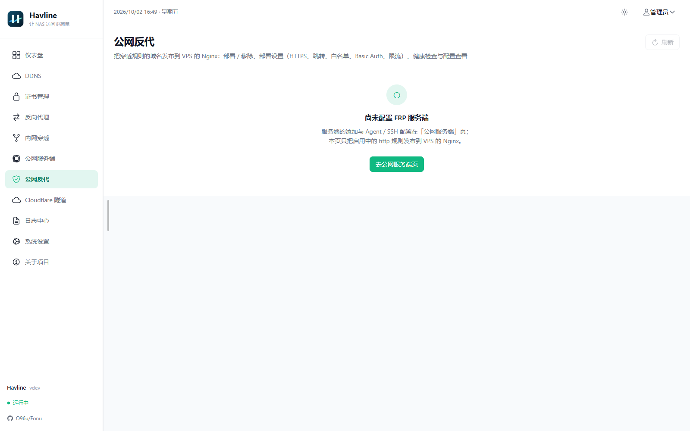

### 8.1 前置条件

需要：

1. 已在「公网服务端」添加 VPS。
2. Agent 已安装并在线。
3. VPS 已安装 Nginx，或允许 Agent 自动安装。
4. 已在「内网穿透」创建可部署规则。

### 8.2 部署反代

操作流程：

1. 在规则台账中找到目标规则。
2. 点击「部署反代」。
3. 等待部署完成。
4. 查看健康四段：

```text
DNS
证书
隧道
服务
```

5. 四段全部通过后，域名访问生效。

### 8.3 部署设置

操作：

1. 点击「部署设置」。
2. 配置基础选项：

```text
启用 HTTPS
HTTP 强制跳转 HTTPS
WebSocket 支持
上传大小限制
代理读超时
```

3. 配置访问控制：

```text
IP 白名单
IP 黑名单
仅中国大陆 IP
Basic Auth
```

4. 配置限流：

```text
请求限流（次/秒）
突发允许量
每 IP 连接数上限
```

5. 配置安全响应头和 TLS 1.3。
6. 点击「保存并重新部署」。

注意事项：

- IP 白名单优先级最高。
- Basic Auth 密码留空时首次部署会自动生成，只在本次响应中显示。
- 限流触发返回 429，连接数超限返回 503。
- 仅中国大陆 IP 依赖本地中国 IP 段数据。

### 8.4 移除反代

操作：

1. 在规则台账中点击「移除反代」。
2. 确认移除。

移除后，VPS 上对应的 Nginx 配置会删除，内网穿透规则本身保留。

### 8.5 配置查看和历史回滚

操作：

1. 点击「查看配置」。
2. 查看当前生成的 Nginx 配置。
3. 切换到历史版本。
4. 选择版本后点击「回滚」。

### 8.6 部署漂移

当 VPS 上的配置与 Havline 记录不一致时，页面会显示部署漂移。

操作：

1. 查看漂移类型：

```text
未部署
孤儿配置
未生效
内容不一致
```

2. 点击「重新部署全部」修复。
3. 或逐条重新部署。

## 九、Cloudflare 隧道

Cloudflare 隧道用于在没有公网 IP 的情况下，通过 `cloudflared` 把内网 Web 服务发布到 Cloudflare 边缘。

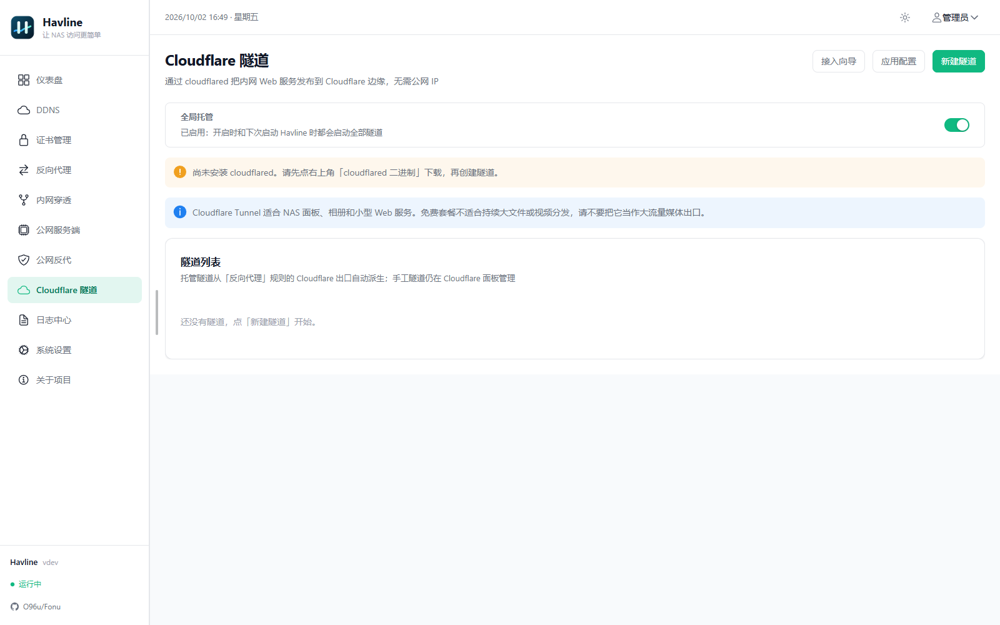

### 9.1 全局托管

页面顶部有「全局托管」开关。

操作：

1. 开启后，Havline 启动时会启动全部隧道。
2. 关闭后，所有隧道停止，应用重启后也不会自动拉起。

### 9.2 接入向导

操作：

1. 点击「接入向导」。
2. 按检查项处理：

```text
cloudflared 二进制
Account ID
API Token
Zone 权限
DNS 权限
```

3. 未通过的项目点击「去配置」。
4. 点击「重新检查」。

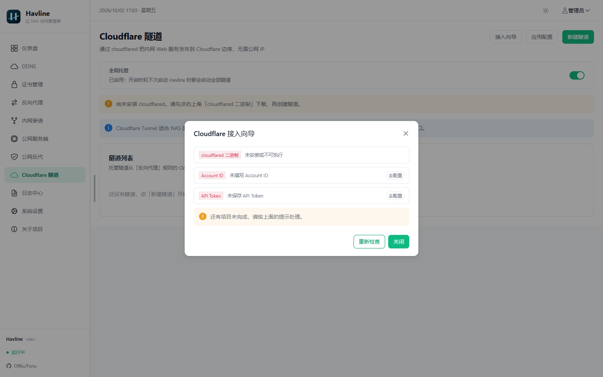

向导检查项：

```text
cloudflared 二进制
Account ID
API Token
Zone 权限
DNS 权限
```

操作顺序：

1. 点击「接入向导」。
2. 查看每一项状态。
3. 未通过的项目点击「去配置」。
4. 配置完成后点击「重新检查」。
5. 全部通过后关闭向导。

### 9.3 应用配置

操作：

1. 点击「应用配置」。
2. 在「cloudflared 二进制」中：

```text
选择下载镜像
检查更新
下载并安装
回滚上一版
```

3. 填写 Account ID。
4. 填写 API Token。
5. 点击「测试连接」。
6. 配置网络调优：

```text
传输协议
边缘地址族
HA 连接数
代理模式
```

7. 点击「保存配置」。

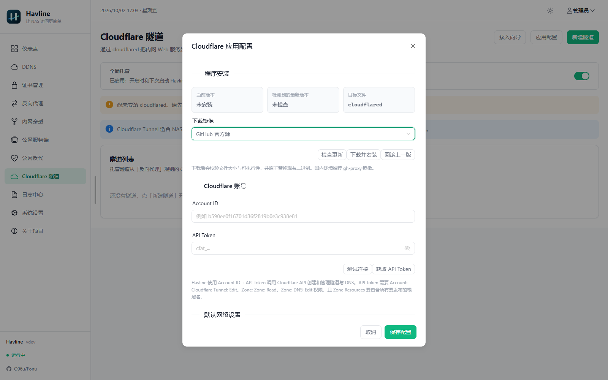

弹窗操作顺序：

1. 点击「应用配置」。
2. 选择下载镜像。
3. 点击「下载并安装」。
4. 填写 Account ID。
5. 填写 API Token。
6. 点击「测试连接」。
7. 配置传输协议、边缘地址族、HA 连接数和代理模式。
8. 点击「保存配置」。

API Token 权限建议：

```text
Account: Cloudflare Tunnel: Edit
Zone: Zone: Read
Zone: DNS: Edit
```

### 9.4 新建隧道

操作流程：

1. 点击「新建隧道」。
2. 填写隧道名称。
3. 选择是否自动托管。
4. 手工隧道需要填写：

```text
子域名（可选）
域
服务
```

5. 选择「随 Havline 自动启动」。
6. 点击「保存」。

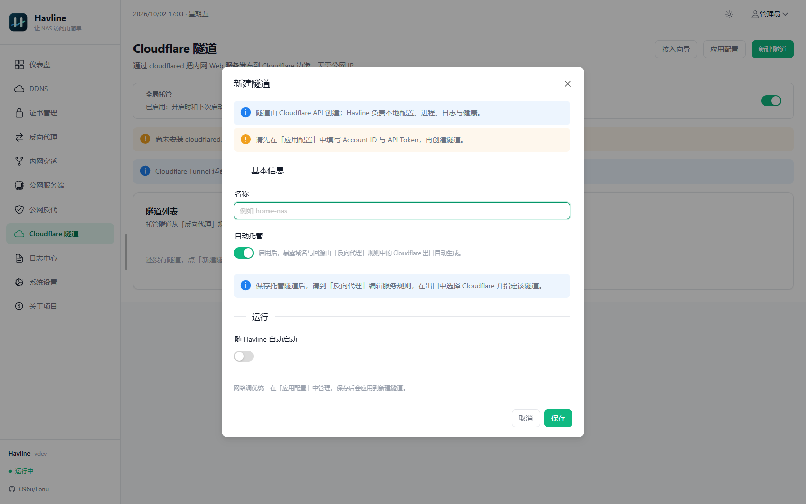

弹窗字段说明：

- 名称：隧道名称。
- 自动托管：开启后由反向代理规则自动生成路由。
- 子域名：可选，例如 `999`。
- 域：从 Cloudflare Zone 选择。
- 服务：回源地址，例如 `192.168.11.30:8001`。
- 随 Havline 自动启动：Havline 启动时自动拉起隧道。

托管隧道保存后，需要到「反向代理」规则的出口中选择 Cloudflare，并指定该隧道。

### 9.5 隧道列表

列表显示：

```text
名称
状态
副本
版本
路由
操作
```

支持操作：

```text
详情
配置
启动
停止
重启
修复
删除
```

### 9.6 隧道详情

详情页包含：

- 状态；
- 本地配置；
- 漂移与诊断；
- 检查漂移；
- 以本地覆盖；
- 运行诊断；
- 检查 Access；
- 刷新凭据；
- 刷新全部。

### 9.7 隧道配置页

配置页包含：

```text
基础配置
路由
运行控制
```

路由操作：

1. 点击「添加路由」。
2. 填写子域名、域和服务。
3. 保存路由。
4. 可以复制、测试、编辑、删除路由。
5. 手工隧道可以上移或下移路由。

运行控制：

```text
启动
停止
重启
```

## 十、日志中心

日志中心用于排查系统、代理、穿透和隧道问题。

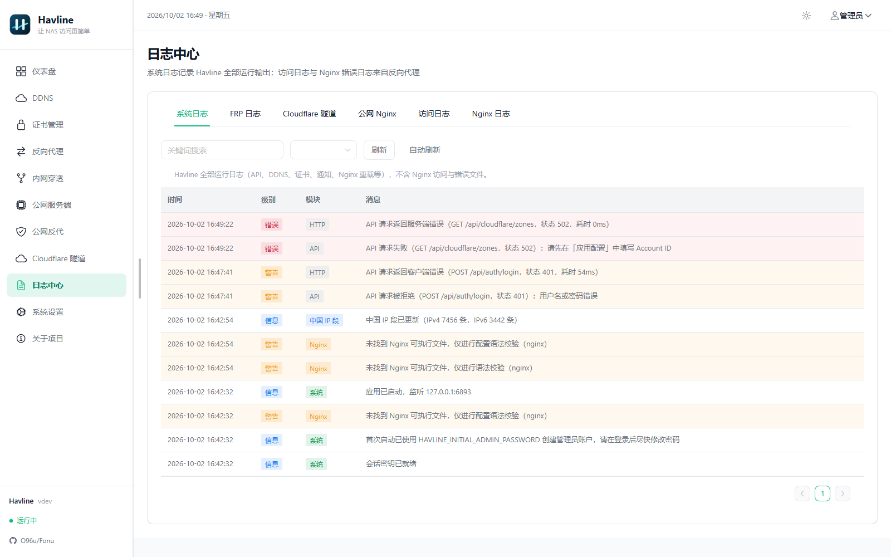

### 10.1 日志分类

页面包含以下页签：

```text
系统日志
FRP 日志
Cloudflare 日志
公网 Nginx 日志
访问日志
Nginx 日志
```

### 10.2 系统日志

记录 Havline 全部运行输出：

- API；
- DDNS；
- 证书；
- 通知；
- Nginx 重载；
- 应用启动和停止。

### 10.3 FRP 日志

记录 frpc 运行日志：

```text
时间
级别
来源
消息
```

用于排查隧道登录、注册和连接错误。

### 10.4 Cloudflare 日志

操作：

1. 选择 Cloudflare 隧道。
2. 查看连接与错误日志。

### 10.5 公网 Nginx 日志

操作：

1. 选择服务端。
2. 选择访问日志或错误日志。
3. 查看 VPS 上的 Nginx 日志。

需要 Agent 版本支持。

### 10.6 访问日志和 Nginx 日志

访问日志记录经 Nginx 反向代理的访问。

Nginx 日志记录：

```text
SSL 握手失败
上游连接异常
配置冲突
```

### 10.7 筛选和分页

支持按关键词、级别和时间筛选，使用分页查看历史日志。

## 十一、系统设置

系统设置集中管理界面、自动任务、证书、数据、通知、安全、令牌和状态页。

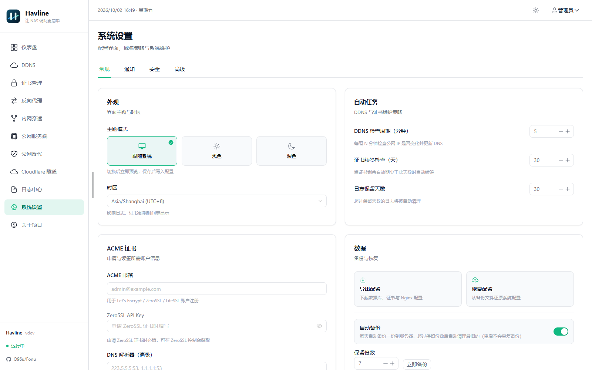

### 11.1 外观

可以设置：

```text
主题
时区
```

时区影响日志、证书到期时间等显示。

### 11.2 自动任务

可以设置：

```text
证书续签检查天数
日志保留天数
```

证书剩余有效期低于阈值时自动续签。

### 11.3 ACME 证书

可以设置：

```text
ACME 邮箱
ZeroSSL API Key
DNS Resolver
LiteSSL EAB Kid
LiteSSL EAB HMAC
```

### 11.4 数据备份与恢复

操作：

1. 点击「导出配置」下载备份。
2. 点击「恢复配置」上传备份并还原。
3. 开启「自动备份」。
4. 设置保留份数。
5. 点击「立即备份」。
6. 在备份列表中恢复或删除备份。

注意：

- 恢复会覆盖当前数据库、证书和 Nginx 配置。
- 恢复前建议先手动导出一次备份。

### 11.5 通知

支持：

```text
邮件
Bark
ntfy
Gotify
企业微信
钉钉
飞书
Webhook
Telegram
```

操作：

1. 选择通知方式。
2. 填写对应参数。
3. 选择需要通知的事件。
4. 点击「测试通知」。
5. 保存设置。

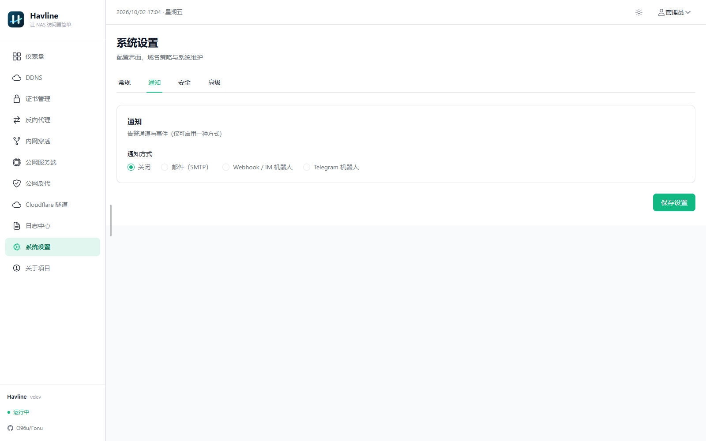

通知操作顺序：

1. 选择通知方式。
2. 填写对应参数。
3. 勾选需要通知的事件。
4. 点击「测试通知」。
5. 确认收到测试消息。
6. 点击「保存设置」。

### 11.6 安全

包含：

```text
反代安全
可信代理 CIDR
IP 白名单
IP 黑名单
管理员密码
Nginx 全局配置
API Token
公开状态页
```

管理员密码：

1. 输入新密码。
2. 点击「修改密码」。

Nginx 全局配置：

1. 查看自动生成的全局配置。
2. 点击「手动编辑」。
3. 保存前会备份。
4. 失败时点击「回滚」或「恢复自动生成」。

API Token：

1. 填写令牌名称。
2. 点击「创建令牌」。
3. 立即复制明文令牌。
4. 不再使用时点击「撤销」。

公开状态页：

1. 开启开关。
2. 设置访问码。
3. 点击「打开状态页」预览。

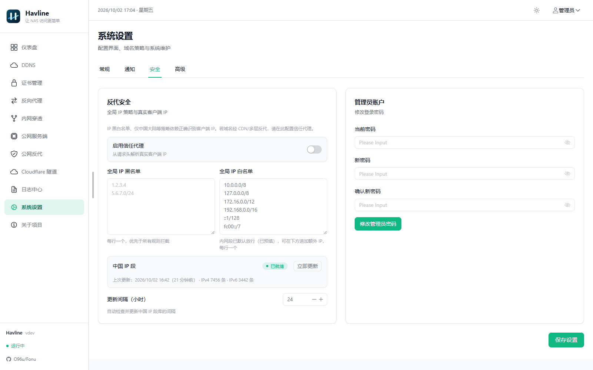


安全页操作顺序：

1. 配置可信代理 CIDR。
2. 配置 IP 白名单和黑名单。
3. 修改管理员密码。
4. 配置 Nginx 全局配置。
5. 创建 API Token。
6. 开启公开状态页。
7. 设置访问码。
8. 点击「保存设置」。

## 十二、关于项目

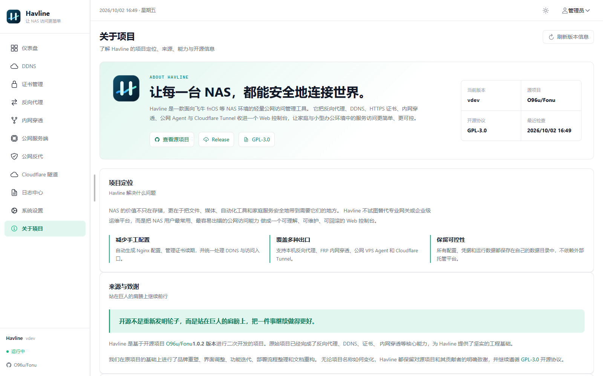

页面展示：

```text
当前版本
源项目
开源协议
项目定位
核心能力
技术栈
开源与许可
```

操作：

1. 点击「刷新版本信息」。
2. 点击「查看源项目」。
3. 查看 Release 和许可证信息。

## 十三、公开状态页

公开状态页默认关闭。

开启方式：

1. 进入「系统设置 → 安全」。
2. 找到「公开状态页」。
3. 开启开关。
4. 设置访问码。
5. 保存设置。
6. 点击「打开状态页」。

访问地址：

```text
http://<NAS-IP>:6893/status
```

或：

```text
https://<你的域名>/status
```

状态页只展示：

```text
域名
24 小时可用率
事故记录
```

不会展示：

```text
内网地址
端口
证书路径
```

访问码只保存 SHA-256，忘记后只能重设。

## 十四、常见操作流程

### 14.1 添加第一个反向代理

```text
1. 进入「反向代理」
2. 点击「新建规则」
3. 填写名称
4. 填写域名，例如 nas.example.com
5. 填写目标地址，例如 http://192.168.1.100:5000
6. 出口选择「本机 Nginx」
7. 启用 HTTPS（需要已有证书）
8. 启用规则并保存
9. 在浏览器访问域名验证
```

### 14.2 申请 HTTPS 证书

```text
1. 先到「DDNS」添加 DNS API 凭证
2. 启用至少一个 DNS 任务
3. 进入「证书管理」
4. 点击「申请证书」
5. 填写证书名称和域名
6. 选择颁发机构和 DNS 验证任务
7. 填写 ACME 邮箱
8. 开始申请
9. 成功后回到「反向代理」启用 HTTPS
```

### 14.3 配置 DDNS

```text
1. 进入「DDNS」
2. 点击「添加任务」
3. 选择服务商
4. 填写凭证
5. 点击「测试连接」
6. 保存服务商
7. 添加解析记录
8. 点击「立即同步」
9. 确认域名解析已更新
```

### 14.4 配置 FRP 穿透

```text
1. 进入「公网服务端」
2. 添加 VPS 地址、SSH 和 FRP 认证信息
3. 安装 Agent
4. 生成并部署 frps.toml
5. 进入「内网穿透」
6. 打开「应用配置」
7. 下载并启用 frpc
8. 添加穿透规则
9. 启动 frpc
10. 查看服务端诊断和规则日志
```

### 14.5 部署公网反代

```text
1. 确认 Agent 在线、Nginx 可用
2. 进入「公网反代」
3. 找到目标穿透规则
4. 点击「部署反代」
5. 查看 DNS、证书、隧道、服务四段健康
6. 需要 HTTPS 时打开「部署设置」并启用 HTTPS
7. 需要安全策略时配置白名单、Basic Auth 和限流
8. 保存并重新部署
9. 访问域名验证
```

### 14.6 创建 Cloudflare 隧道

```text
1. 进入「Cloudflare 隧道」
2. 点击「应用配置」
3. 下载 cloudflared
4. 填写 Account ID 和 API Token
5. 点击「测试连接」
6. 保存配置
7. 点击「新建隧道」
8. 填写名称和路由
9. 保存隧道
10. 启动隧道
11. 访问域名验证
```

### 14.7 备份与恢复

```text
1. 进入「系统设置 → 数据」
2. 点击「导出配置」
3. 保存下载的备份文件
4. 需要恢复时点击「恢复配置」
5. 上传备份文件
6. 确认覆盖当前数据
7. 等待恢复完成
8. 重新登录并验证规则、证书和隧道
```

### 14.8 升级与迁移

Docker 版升级到 Native 版时，请参考：

```text
docs/upgrade-and-migration.md
```

核心原则：

```text
卸载旧版时保留数据
不要删除 ${TRIM_PKGVAR}
保留 session_secret
安装 Native 1.9.1 后启动验证
```

## 十五、故障排查

| 现象 | 可能原因 | 处理方法 |
| --- | --- | --- |
| 无法登录 | 密码错误或数据库异常 | 确认管理员密码，必要时查看系统日志 |
| Nginx 未安装 | 本机没有 Nginx 可执行文件 | 安装 Nginx 或使用包含 Nginx 的 Native 包 |
| DDNS 同步失败 | 凭证错误、域名不存在、公网 IP 检测失败 | 测试连接，检查域名和 DNS API 权限 |
| 证书申请失败 | DNS 验证失败、邮箱错误、CA 限制 | 检查 DNS 任务、ACME 邮箱和 CA 配置 |
| FRP 登录失败 | Token 不一致、frps 未启动、端口未放行 | 对比 frpc 和 frps 配置，检查防火墙 |
| Cloudflare Token 错误 | Token 权限不足 | 确认 Tunnel Edit、Zone Read、DNS Edit |
| Cloudflare DNS 未创建 | Zone 不在当前 Account | 确认根域名已加入当前 Account |
| 公网反代健康失败 | DNS、证书、隧道或服务异常 | 按四段健康逐项检查 |
| 状态页 404 | 状态页未开启或访问码错误 | 在系统设置中开启并设置访问码 |
| 升级后数据异常 | session_secret 丢失或数据目录变更 | 恢复备份，确认数据目录一致 |

### 15.1 Nginx 配置校验失败

操作：

1. 查看错误提示中的配置行号。
2. 打开规则的「Nginx 配置」。
3. 点击「回滚」恢复上一版本。
4. 或点击「恢复自动生成」。

### 15.2 端口冲突

常见端口：

```text
6893：Havline 管理界面
18080：本机 Nginx HTTP
9443：本机 Nginx HTTPS
```

操作：

1. 检查端口是否被其他服务占用。
2. 修改安装向导或系统设置中的端口。
3. 重启 Havline。

### 15.3 公网访问失败

按顺序检查：

```text
DDNS 是否同步
证书是否有效
Nginx 是否运行
反向代理规则是否启用
防火墙是否放行
FRP 或 Cloudflare 隧道是否在线
```

## 十六、安全建议

### 16.1 管理后台

```text
修改默认管理员密码
不要直接暴露 6893 到公网
优先使用统一网关或 VPN
开启 HTTPS
```

### 16.2 反向代理

```text
管理类服务启用 IP 白名单
公开服务启用限流
高风险服务启用 Basic Auth
启用安全响应头
只在需要时开启 WebSocket
```

### 16.3 凭证

```text
DNS API 凭证使用最小权限
Cloudflare Token 只授予必要权限
API Token 创建后立即保存
不要将凭证提交到 Git 仓库
定期轮换 Token
```

### 16.4 数据

```text
开启自动备份
升级前手动导出备份
保留 session_secret
备份文件存放在安全位置
```

### 16.5 飞牛 Native 版

```text
管理入口使用统一网关 /app/havline
frpc 和 cloudflared 按需下载
升级前保留 ${TRIM_PKGVAR}
不要删除 ${TRIM_PKGVAR}/session_secret
```

## 十七、附录

### 17.1 页面路径

| 页面 | 路径 |
| --- | --- |
| 登录 | `/login` |
| 仪表盘 | `/dashboard` |
| DDNS | `/ddns` |
| 证书管理 | `/certificates` |
| 反向代理 | `/proxies` |
| 内网穿透 | `/frp` |
| 公网服务端 | `/frp-agent` |
| 公网反代 | `/public-proxy` |
| Cloudflare 隧道 | `/cloudflare` |
| 隧道配置 | `/cloudflare/:id/config` |
| 日志中心 | `/logs` |
| 系统设置 | `/settings` |
| 关于项目 | `/about` |
| 公开状态页 | `/status` |

### 17.2 截图索引

```text
guide-login.png
guide-dashboard.png
guide-ddns.png
guide-certificates.png
guide-proxy.png
guide-frp.png
guide-agent.png
guide-public-proxy.png
guide-cloudflare.png
guide-logs.png
guide-settings.png
guide-about.png
guide-dialog-ddns-add.png
guide-dialog-cert-apply.png
guide-dialog-cert-import.png
guide-dialog-proxy-create.png
guide-dialog-proxy-discovery.png
guide-dialog-frp-runtime.png
guide-dialog-frp-guide.png
guide-dialog-agent-add.png
guide-dialog-cf-settings.png
guide-dialog-cf-create.png
guide-dialog-cf-preflight.png
guide-settings-notify.png
guide-settings-security.png
guide-settings-status-page.png
```

### 17.3 相关文档

```text
docs/fnos-native-app-plan.md
docs/fnos-unified-gateway-plan.md
docs/upgrade-and-migration.md
docs/gitea-registry-fix.md
```

### 17.4 默认端口

| 用途 | 默认端口 |
| --- | ---: |
| Havline 管理界面 | 6893 |
| 本机 Nginx HTTP | 18080 |
| 本机 Nginx HTTPS | 9443 |
| FRP 默认端口 | 按服务端配置 |
| Cloudflare 隧道 | 无本地监听端口 |
